

<h1 align="center">RR FX</h1>

<h3 align="center">Arrête de faire à la main ce que Premiere Pro pourrait faire tout seul.</h3>

Silences coupés, sous-titres posés, transitions calées sur la musique, LOG converti, version 9:16 prête : 
<b>RR FX fait le travail répétitif du montage en un clic</b>, et tu gardes ton temps pour la partie créative. 
Un plugin <b>gratuit</b> pour Premiere Pro, en français et en anglais.

  

  
  
  
  
  

---

## Regarde-le travailler

<table>
<tr>
<td align="center" width="33%">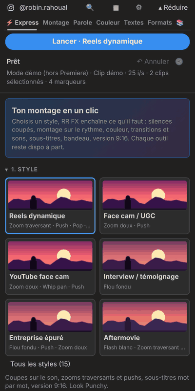 <b>⚡ Express</b> Choisis un style, clique : temps forts, montage, look, effets, sons et version 9:16 s'enchaînent.</td>
<td align="center" width="33%">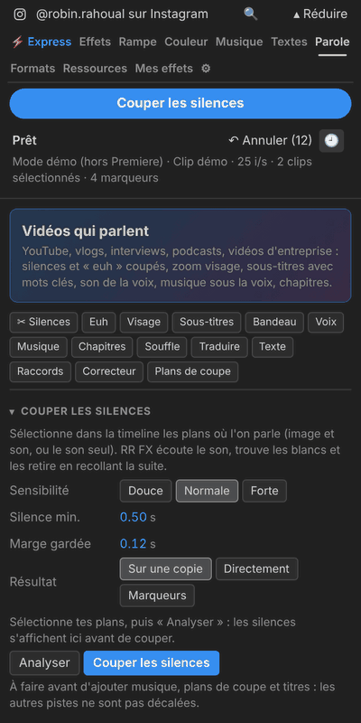 <b>🎙️ Silences coupés</b> RR FX écoute, te montre les blancs en rouge, puis les coupe sur une copie de ta séquence.</td>
<td align="center" width="33%">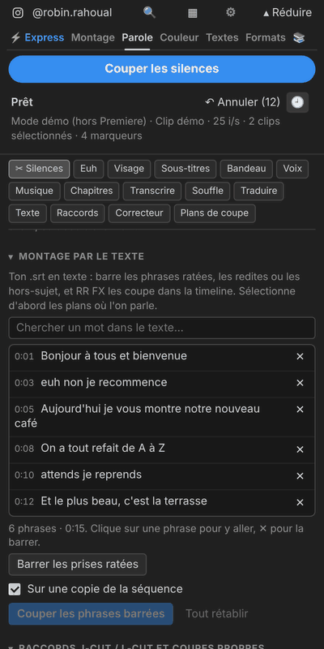 <b>📝 Monter par le texte</b> Barre les phrases ratées dans le texte : elles disparaissent de la timeline.</td>
</tr>
</table>

---

## RR FX en chiffres

<table>
<tr>
<td align="center" width="25%"><h3>50+</h3>outils dans un seul panneau</td>
<td align="center" width="25%"><h3>36</h3>transitions, mouvements et effets</td>
<td align="center" width="25%"><h3>14</h3>styles Express prêts à l'emploi</td>
<td align="center" width="25%"><h3>16</h3>overlays fournis (light leaks, VHS…)</td>
</tr>
<tr>
<td align="center"><h3>20</h3>speed ramps prédéfinies</td>
<td align="center"><h3>24</h3>langues pour traduire tes sous-titres</td>
<td align="center"><h3>45</h3>actions sur une touche ou un Stream Deck</td>
<td align="center"><h3>0 €</h3>pas d'abonnement, pas de compte</td>
</tr>
</table>

---

## Ton montage, avant et avec RR FX

| Ce que tu fais aujourd'hui | Avec RR FX |
|---|---|
| Écouter l'interview, repérer chaque blanc, couper, recoller | **Un clic** : les silences sont coupés sur une copie de ta séquence |
| Taper les sous-titres, les caler, les animer un par un | **Ton `.srt` posé en textes animés**, mot par mot ou phrase par phrase |
| Poser un zoom et un whoosh sur chaque coupe, à la main | **Toutes les coupes d'un coup**, avec leurs sons |
| Glisser un fondu enchaîné et un fondu audio sur chaque coupe | **Les transitions de Premiere sur toutes les coupes**, en un clic |
| Chercher le kick de la musique image par image | **Un marqueur sur chaque temps fort**, trouvé tout seul |
| Recadrer chaque plan pour la version Reels | **Une copie 9:16 qui suit le visage**, en un clic |
| Charger la LUT de ta caméra sur chaque rush | **Un calque de conversion** au-dessus de tous tes rushs, la bonne LUT par caméra |
| Raccourcir la musique pour qu'elle finisse avec la vidéo | **Une coupe invisible entre deux temps forts**, la vraie fin gardée |
| Exporter chaque version, renommer chaque fichier | **Export en lot** dans Media Encoder, avec des noms propres |

Et rien n'est irréversible : **↶ Annuler** retire chaque opération, même ancienne, et les coupes se font par défaut
sur une copie de ta séquence.

---

## Fait pour ton type de vidéo

<table>
<tr>
<td width="25%" valign="top"><b>📱 Reels, TikTok, Shorts</b> Express « Reels dynamique », sous-titres mot par mot, mots clés en couleur, copie 9:16, extraits d'une longue vidéo, barre de progression. <a href="#express">Voir les outils</a></td>
<td width="25%" valign="top"><b>🎙️ Interviews, entreprise, podcasts</b> Silences et « euh » coupés, montage par le texte, J-cut et L-cut, bandeau nom et fonction, voix égalisée, fond flou en 9:16. <a href="#parole">Voir les outils</a></td>
<td width="25%" valign="top"><b>▶️ YouTube et vlogs</b> Zoom visage sur les jump cuts, chapitres YouTube, musique sous la voix, plans de coupe sur les mots clés, rythme du montage. <a href="#parole">Voir les outils</a></td>
<td width="25%" valign="top"><b>🎵 Clips, mariages, aftermovies</b> Effets sur les temps forts, montage auto sur le rythme, speed ramps, overlays, conversion LOG, raccord entre caméras, looks. <a href="#musique">Voir les outils</a></td>
</tr>
</table>

---

## Pourquoi les monteurs l'adoptent

- **🛡️ Ton montage ne bouge pas.** Les effets se posent sur des calques au-dessus de tes plans. Tes clips, ton son et
  tes coupes ne sont jamais modifiés, et les coupes se font sur une copie de ta séquence si tu veux.
- **🎯 Précis.** Chaque effet est posé pile sur ta coupe, tes marqueurs ou chaque temps fort, avec son son.
- **✏️ Tout reste modifiable.** Ce que pose RR FX est une image clé ou un effet Premiere normal : tu le retouches
  dans *Options d'effet*, comme si tu l'avais fait à la main.
- **🧰 Un seul panneau.** Montage, parole, musique, couleur, textes, formats, livraison, ressources : plus besoin de
  dix plugins.
- **🧪 Fiable.** Un test de compatibilité vérifie ton Premiere en un clic. Les mises à jour s'installent depuis le
  panneau, avec retour arrière si quelque chose se passe mal.
- **⏱️ Tu vois ce que tu gagnes.** RR FX compte le temps qu'il t'a fait gagner, et le temps passé sur chaque projet.
- **🎁 Gratuit.** Pas d'abonnement, pas de compte, pas de publicité.

---

## Sommaire

| | | |
|---|---|---|
| [⚡ Express](#express) | [🎙️ Vidéos qui parlent](#parole) | [🎵 Musique et rythme](#musique) |
| [✨ Effets, transitions, rampes](#effets) | [🎨 Couleur](#couleur) | [🔤 Textes et habillage](#textes) |
| [📱 Formats et livraison](#formats) | [🗂️ Projet et ressources](#projet) | [🚀 Ton flux de travail](#flux) |

**Nouveau dans la 2.7** : les **outils de Premiere en un clic** (transitions et fondus audio sur toutes les coupes,
détection des changements de plan, piste de sous-titres native), des **onglets regroupés**, le menu **Fenêtres**
pour n'afficher que tes outils, des **espaces de travail**, et les mises à jour **signées**. [Toutes les nouveautés](https://github.com/RobinRahoual/RRFX/releases/latest)

---

## ⚡ Express : ton montage en un clic

> **Le problème :** chaque vidéo demande les mêmes vingt étapes, toujours dans le même ordre.
> **La solution :** tu choisis un style, RR FX les enchaîne pour toi.

### Un style, un clic, une vidéo montée

Choisis un style, clique sur **Lancer**. RR FX enchaîne **dans l'ordre** les étapes de ce style :

1. coupe les silences (sur une copie de ta séquence) ou pose les temps forts de ta musique ;
2. monte tes rushs sur le rythme ;
3. convertit ton LOG en Rec.709, corrige l'expo, pose le look ;
4. zoome un plan sur deux sur les jump cuts, pose les transitions **et leurs sons** sur chaque coupe ;
5. pose les sous-titres, le bandeau nom et fonction ou les paroles, puis la version 9:16.

**14 styles prêts à l'emploi** : Reels dynamique, Face cam / UGC, YouTube face cam, Interview / témoignage,
Entreprise épuré, Aftermovie, Mariage / cérémonie, Vlog voyage, Cinématique, Rap énergique, Drill sombre, Pop
lumineux, Chill / lofi, Rétro VHS… et **ton style** à toi, enregistré une fois.

- ✅ Seules les étapes utiles sont proposées : pas de musique pour une interview, pas de souci.
- ✅ Avant de lancer, RR FX vérifie ce qui manque (séquence, musique, `.srt`) et te le dit.
- ✅ Un compte rendu clair à la fin, et **↶ Annuler** retire une étape à la fois.

<table>
<tr>
<td align="center" width="33%"> <b>1.</b> Choisis ton style</td>
<td align="center" width="33%">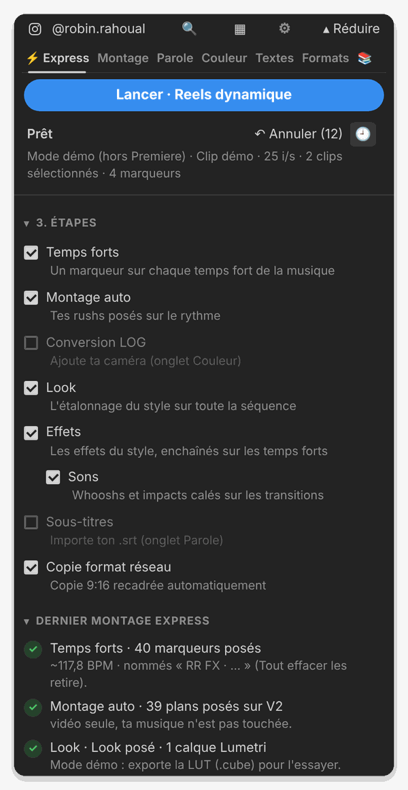 <b>2.</b> Garde les étapes utiles</td>
<td align="center" width="33%">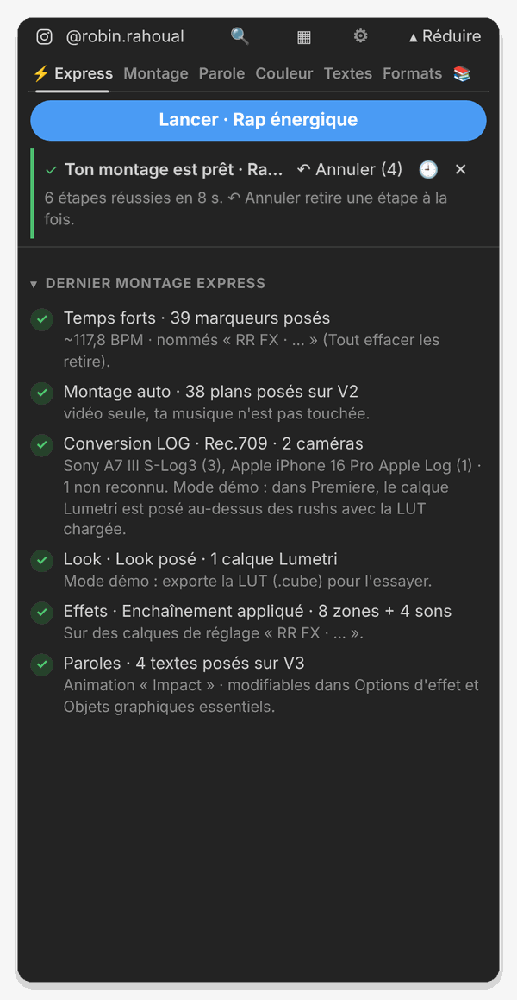 <b>3.</b> Ton montage est prêt</td>
</tr>
<tr>
<td align="center">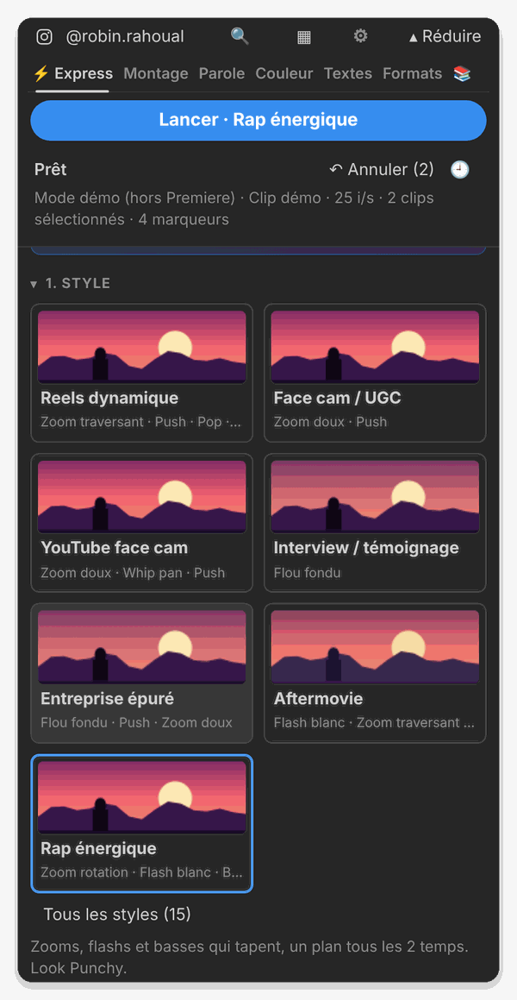 Les styles de musique : rap, drill, pop, lofi…</td>
<td align="center"> Interview : silences, fond flou, sous-titres</td>
<td align="center"> Ou pars d'un modèle de projet</td>
</tr>
</table>

<a href="#sommaire">⬆ Sommaire</a>

---

## 🎙️ Vidéos qui parlent

Interviews, podcasts filmés, YouTube, vidéos d'entreprise, face cam : tout ce qui prend des heures quand quelqu'un
parle à la caméra.

### Couper les silences en un clic

> **Le problème :** une interview de 20 minutes, c'est des dizaines de blancs à repérer, couper et recoller.

1. Sélectionne tes plans, clique **Analyser** : RR FX écoute le son et te montre les blancs en rouge.
2. Règle la sensibilité, le silence minimum et la marge autour des mots si besoin.
3. **Couper les silences** : l'image et le son sont recollés, toujours synchro.

- ✅ Par défaut sur **une copie** de ta séquence : l'originale reste intacte. Ou juste un marqueur sur chaque blanc.
- ✅ Les sous-titres se recalent tout seuls sur le nouveau montage.

<table>
<tr>
<td align="center" width="33%"> Les blancs repérés, rien n'est encore coupé</td>
<td align="center" width="33%">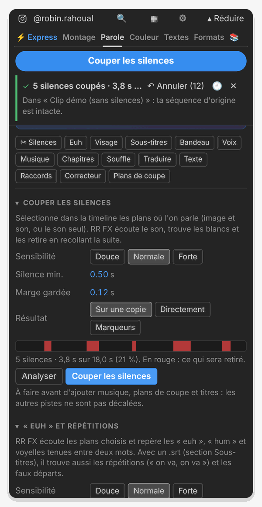 Coupés, sur une copie de ta séquence</td>
<td align="center" width="33%">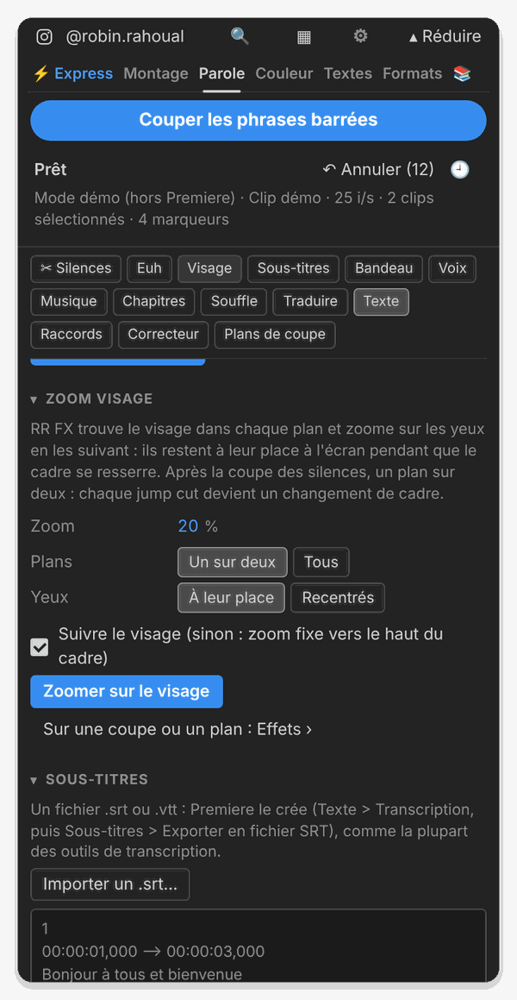 Puis un zoom visage un plan sur deux</td>
</tr>
</table>

### Les « euh » et les répétitions en moins

RR FX repère dans le son les **« euh », « hum » et hésitations** (une voyelle tenue entre deux pauses), et dans
ton `.srt` les **répétitions** (« on va, on va ») et les **faux départs**.

- ✅ Coupés sur une copie, directement, ou simplement **marqués** pour vérifier d'abord.
- ✅ Trois sensibilités, et les sous-titres recalés sur chaque coupe.

<table>
<tr>
<td align="center" width="50%"> Sensibilité et façon de couper</td>
<td align="center" width="50%">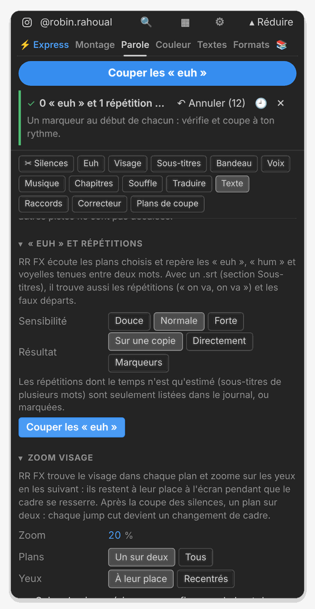 Marqués pour vérifier avant de couper</td>
</tr>
</table>

### Monter en barrant du texte

> **Le problème :** retrouver dans la timeline la phrase ratée que tu as entendue il y a dix minutes.

Ton `.srt` s'affiche comme un texte, phrase par phrase. **Barre une phrase, elle disparaît de la timeline.**

- ✅ **Un clic sur une phrase** : la tête de lecture y va.
- ✅ **Barrer les prises ratées** : RR FX repère tout seul les phrases recommencées et les « attends, je reprends ».
- ✅ **Cherche un mot** dans tout le texte, et barre d'un coup les phrases trouvées.
- ✅ Les coupes se font sur une copie si tu veux, et les sous-titres restants sont **recalés**.

<table>
<tr>
<td align="center" width="33%"> Barre les phrases à retirer</td>
<td align="center" width="33%">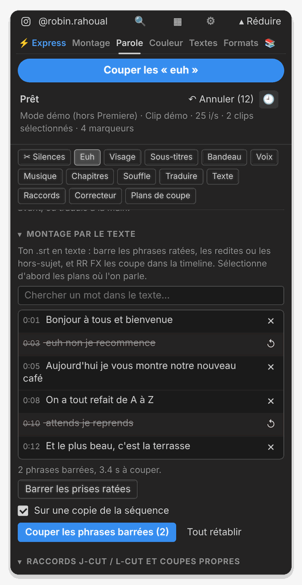 Les prises ratées trouvées toutes seules</td>
<td align="center" width="33%">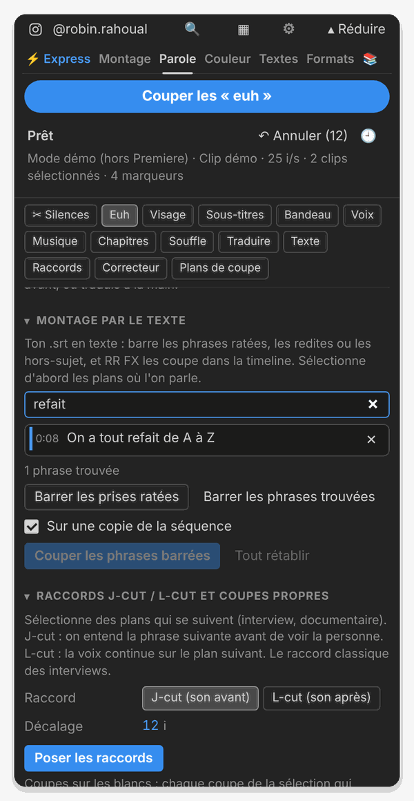 Cherche un mot dans toute l'interview</td>
</tr>
</table>

### J-cut, L-cut et coupes propres

> **Le problème :** des coupes « cut sec » qui font amateur, et des mots coupés en deux.

- **J-cut / L-cut en un clic** sur toutes les coupes de la sélection : on entend la phrase suivante avant de voir la
  personne, ou la voix continue sur le plan d'après. Le raccord des documentaires.
- **Coupes sur les blancs** : RR FX écoute chaque coupe ; si elle tombe au milieu d'un mot, elle glisse de quelques
  images vers le blanc le plus proche, image et son ensemble.
- ✅ Le décalage se règle en images, et **↶ Annuler** remet les coupes droites.

<table>
<tr>
<td align="center" width="33%">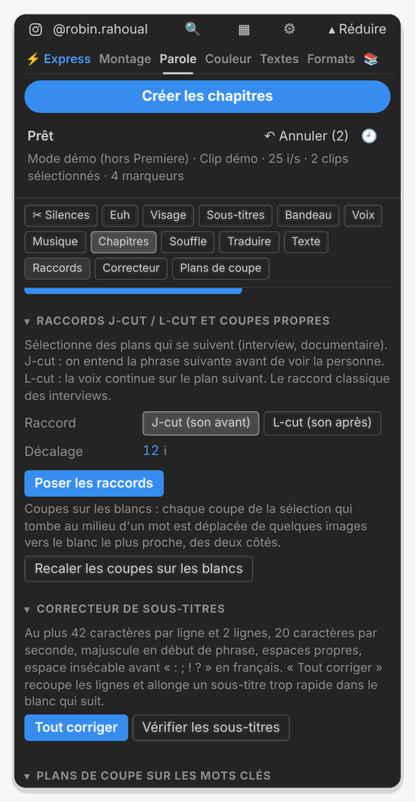 J-cut ou L-cut, décalage en images</td>
<td align="center" width="33%">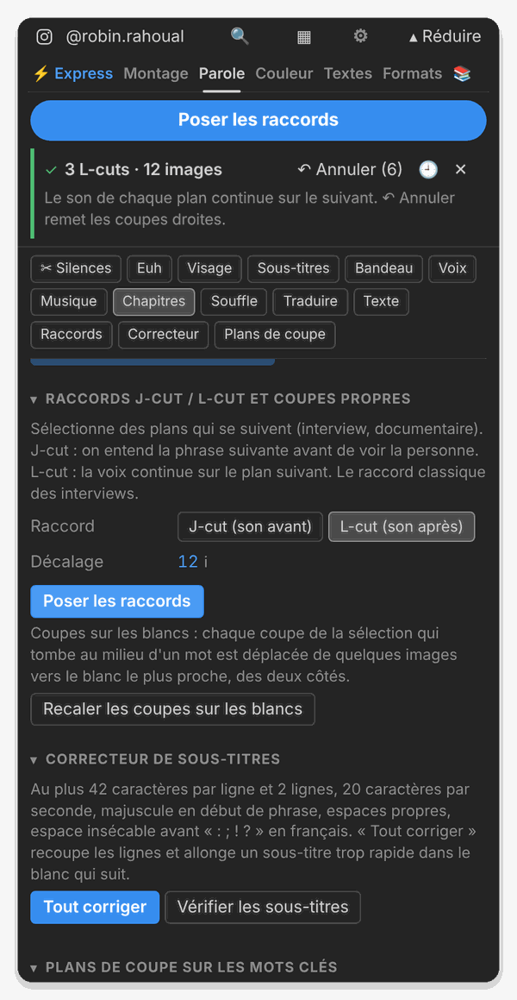 Posés sur toutes les coupes</td>
<td align="center" width="33%">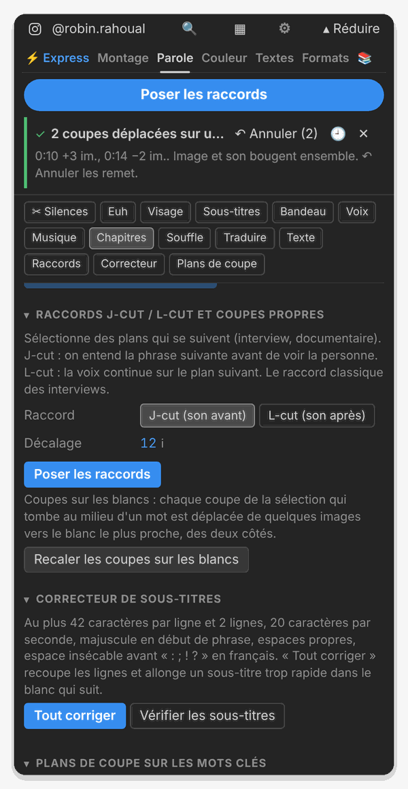 Les coupes recalées sur les blancs</td>
</tr>
</table>

### Sous-titres animés, mots clés et bandeaux

- **Sous-titres** : importe un `.srt` (Premiere le crée avec sa transcription) et RR FX pose chaque phrase en texte
  animé. **Mot par mot** pour le style TikTok, 3 mots, ou la phrase entière.
- **Mots clés en couleur** : chiffres, mots forts et ta propre liste ressortent en jaune (ou ta couleur), avec un
  **emoji** et un petit **« pop » sonore** en option.
- **Bandeau nom et fonction** pour tes interviews, animé, en bas à gauche, au centre ou en haut.

<table>
<tr>
<td align="center" width="33%"> Ton .srt en textes animés</td>
<td align="center" width="33%">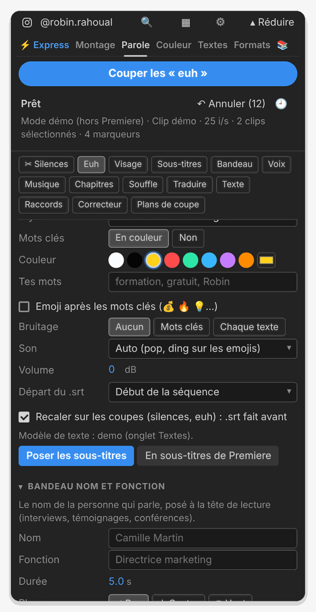 Mots clés, emojis et bruitages</td>
<td align="center" width="33%">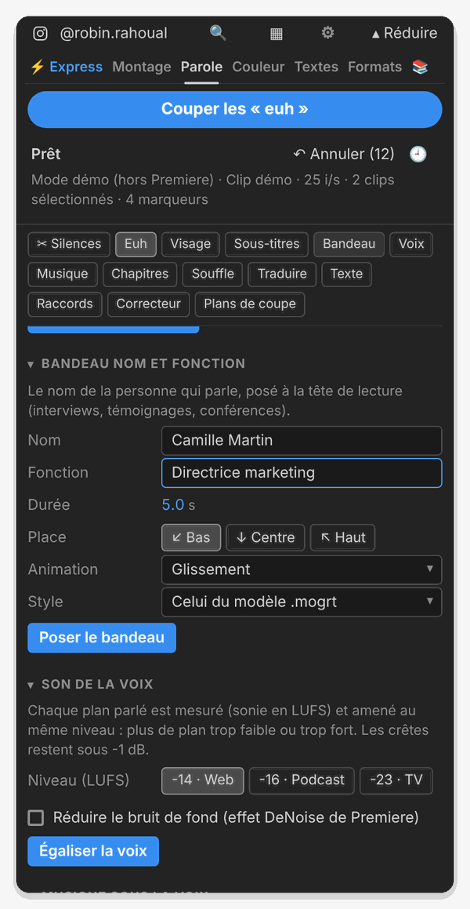 Bandeau nom et fonction</td>
</tr>
</table>

### Des sous-titres propres, et dans 24 langues

- **Correcteur** : lignes de plus de 42 caractères, lecture trop rapide (plus de 20 caractères par seconde),
  sous-titres trop courts, majuscules oubliées, espaces en trop, espace avant « : ; ! ? ». **Tout corriger**
  recoupe les lignes, allonge les sous-titres trop rapides et répare la ponctuation.
- **Traduction** sous-titre par sous-titre, **les timings ne bougent pas** : MyMemory (gratuit, sans compte) ou
  DeepL (avec ta clé, gratuite jusqu'à 500 000 caractères par mois).

<table>
<tr>
<td align="center" width="33%">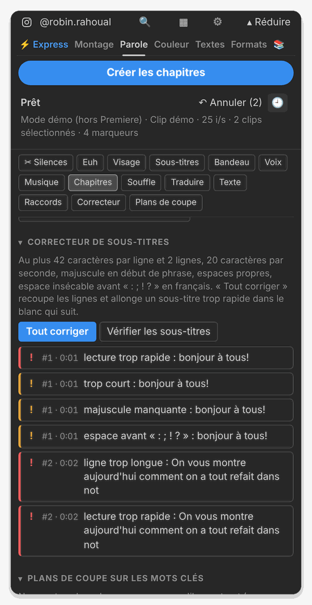 Les problèmes listés, un clic pour y aller</td>
<td align="center" width="33%">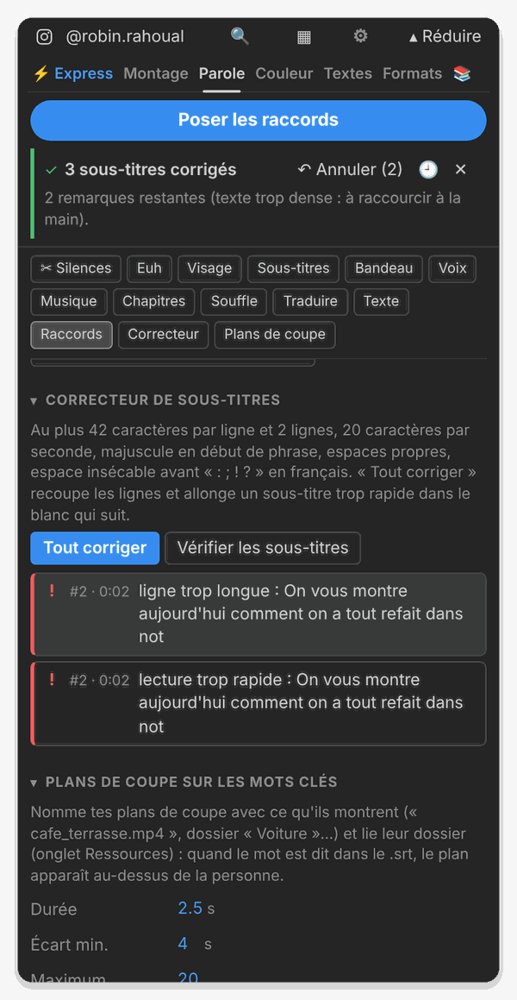 Tout corrigé en un clic</td>
<td align="center" width="33%"> Traduit dans 24 langues</td>
</tr>
</table>

### Le son de la voix réglé tout seul

- **Égaliser la voix** : chaque plan parlé amené au même niveau (-14 LUFS pour YouTube et les réseaux, -16
  podcast, -23 TV), sans dépasser -1 dB. Débruitage en option.
- **Musique sous la voix** : elle baisse quand on parle et remonte dans les pauses.
- **Respirations et clics de bouche** baissés sans rien couper (-6, -12, -20 dB ou muet).
- **Chapitres YouTube** : la liste « 00:00 Titre » prête à coller, depuis tes marqueurs ou les blancs du `.srt`.

<table>
<tr>
<td align="center" width="33%"> Voix égalisée, musique sous la voix</td>
<td align="center" width="33%"> Respirations et clics baissés</td>
<td align="center" width="33%">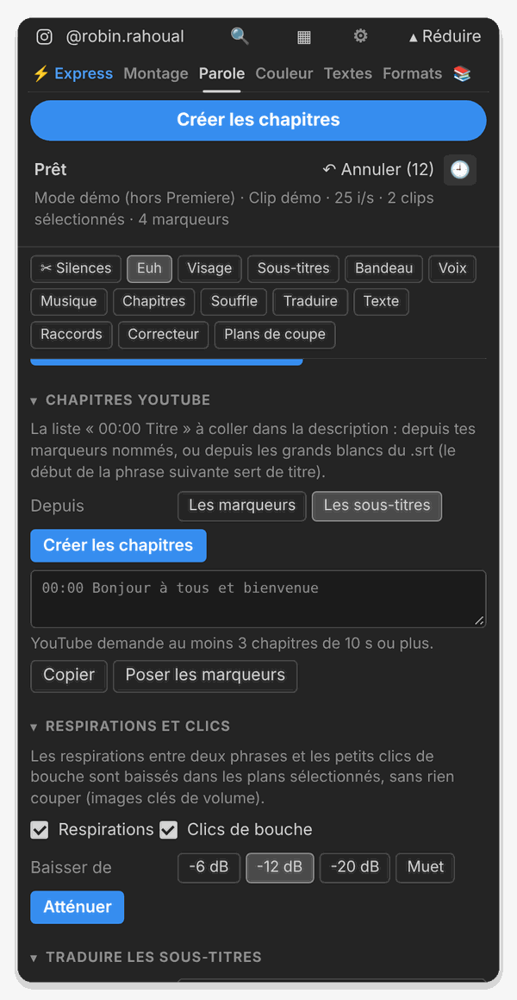 Chapitres YouTube prêts à coller</td>
</tr>
</table>

### Des plans de coupe sur les mots clés

Nomme tes plans de coupe comme ce qu'ils montrent (`logo.mp4`, `cafe_terrasse.mov`…) : quand le mot est dit dans
les sous-titres, le plan apparaît au-dessus de la personne qui parle.

- ✅ **Voir les correspondances** avant de poser : chaque mot et le plan qu'il appelle.
- ✅ Durée, écart minimum et nombre maximum réglables.

<a href="#sommaire">⬆ Sommaire</a>

---

## 🎵 Musique et rythme

### Les temps forts de ta musique, trouvés tout seuls

> **Le problème :** chercher le kick image par image pour caler une coupe.

RR FX écoute ta musique et trouve **les kicks, les caisses claires ou la grille du tempo**. Un clic pose un marqueur
sur chaque temps fort, et les effets, les textes et le montage auto s'en servent directement.

- ✅ **Des effets qui s'enchaînent** sur les temps forts : zoom sur le kick, flash sur la caisse claire, shake sur le
  drop, dans l'ordre ou au hasard.
- ✅ **L'intensité suit le volume** : plus doux sur le couplet, plus fort sur le refrain.

<table>
<tr>
<td align="center" width="33%"> Le morceau analysé, les temps forts trouvés</td>
<td align="center" width="33%"> Plusieurs effets qui s'enchaînent</td>
<td align="center" width="33%">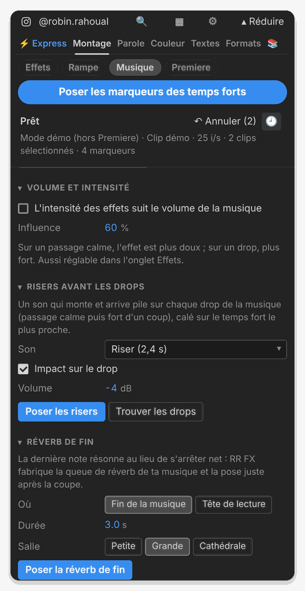 L'intensité qui suit la musique</td>
</tr>
</table>

### Le montage qui se fait tout seul

- **Montage auto** : tes rushs posés l'un après l'autre, un plan tous les 1, 2, 4 ou 8 temps.
- **Synchro son/image en un clic** : en playback, l'image se cale sur la musique ; en multicam, les caméras se
  calent entre elles.
- **Multicam sur le rythme** : une caméra différente à chaque temps fort.

<table>
<tr>
<td align="center" width="50%"> Un plan tous les N temps</td>
<td align="center" width="50%">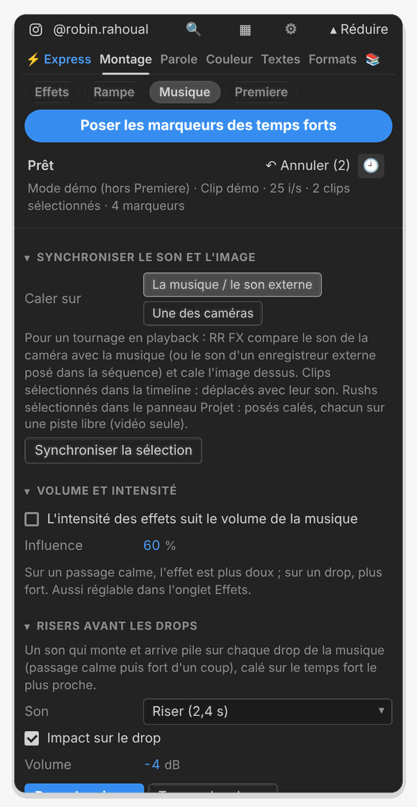 Synchro playback et multicam</td>
</tr>
</table>

### La musique finit pile avec ta vidéo

> **Le problème :** une musique de 3 minutes pour une vidéo d'1 min 05, et un fondu bricolé à la fin.

RR FX retire un passage **au milieu, entre deux temps forts** (des mesures entières si possible) : le morceau garde
son intro et **sa vraie fin**, qui tombe pile avec la dernière image.

- ✅ Tu vois **où sera la coupe** avant de la faire.
- ✅ Une version de la séquence est gardée avant, au cas où.

<table>
<tr>
<td align="center" width="50%"> La coupe prévue, avant de toucher à rien</td>
<td align="center" width="50%">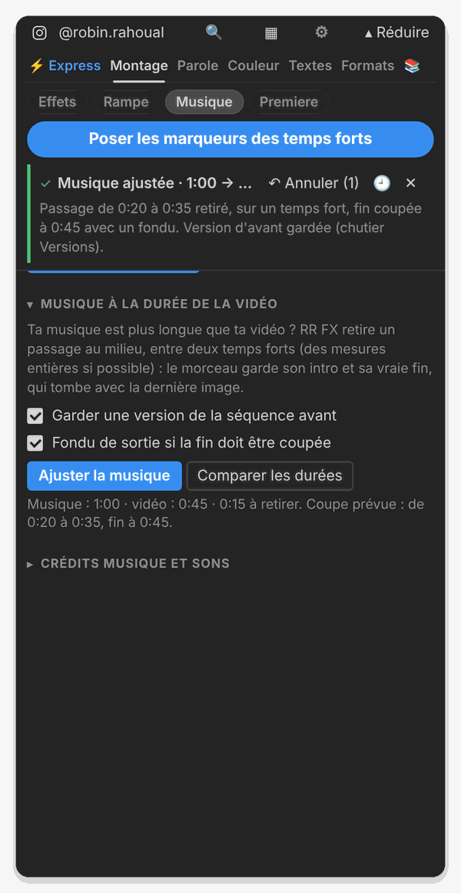 La musique finit avec la vidéo</td>
</tr>
</table>

### Risers, réverb de fin et crédits

- **Risers** : RR FX trouve les drops de ta musique et pose un riser qui finit pile dessus, avec un impact si tu
  veux.
- **Réverb de fin** : la musique s'arrête où tu veux et **résonne** au lieu d'être coupée net.
- **Crédits musique et sons** : toutes les musiques et tous les sons de la séquence, avec leur place et leur durée,
  à copier pour la description ou le client.

<table>
<tr>
<td align="center" width="33%"> Un riser avant chaque drop</td>
<td align="center" width="33%">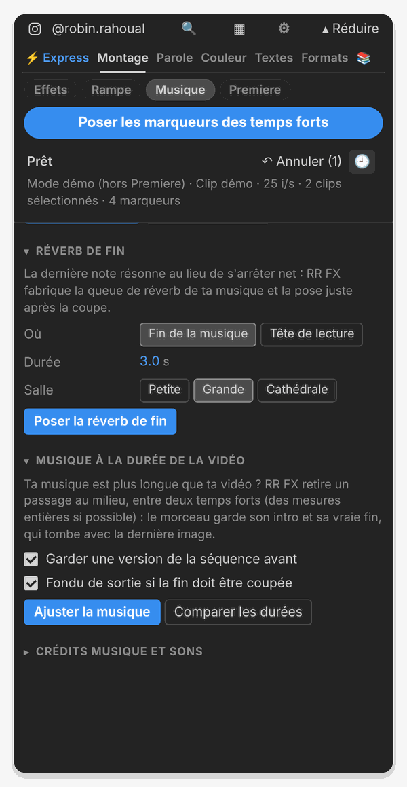 Une fin qui résonne</td>
<td align="center" width="33%">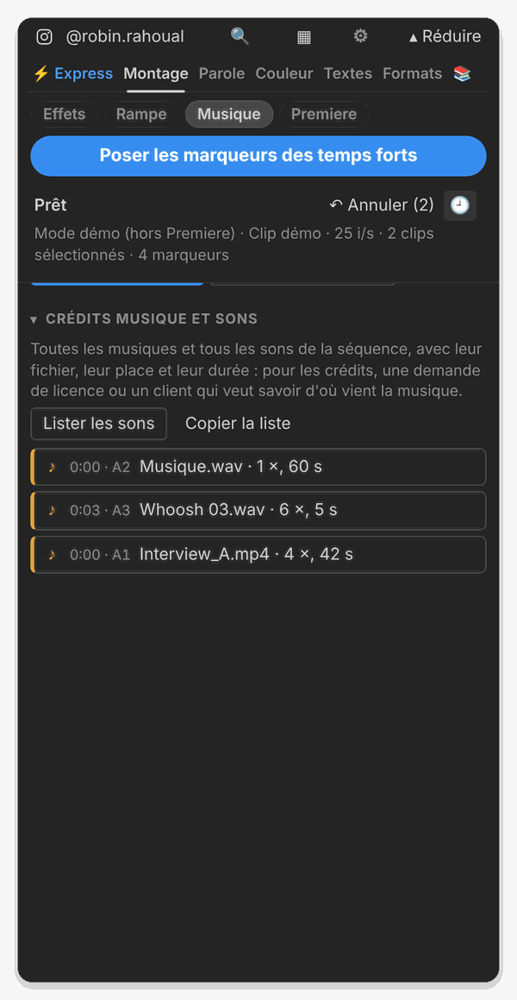 Les crédits prêts à copier</td>
</tr>
</table>

<a href="#sommaire">⬆ Sommaire</a>

---

## ✨ Effets, transitions et rampes

### 36 transitions et effets, posés partout d'un coup

> **Le problème :** poser le même zoom, à la main, sur 40 coupes.

- **Transitions modernes** : push, zoom lent, zoom traversant, pop, fondus au blanc et au noir, fondu flou.
- **Mouvements** : Ken Burns, zoom lent, caméra à l'épaule, punch-in, **zoom visage** qui suit les yeux.
- **Effets de clip** : flashs, flickers, zooms, shakes, glitchs, motion blur.

Survole une vignette pour la voir bouger. Pose l'effet sur **la coupe**, **toutes les coupes de la séquence**,
**tes marqueurs**, **chaque temps fort** ou **tous les plans**, avec **les sons** fournis (whooshs, impacts).

- ✅ Durée, intensité, courbe d'animation : tout se règle, et s'enregistre comme preset.

<table>
<tr>
<td align="center" width="33%">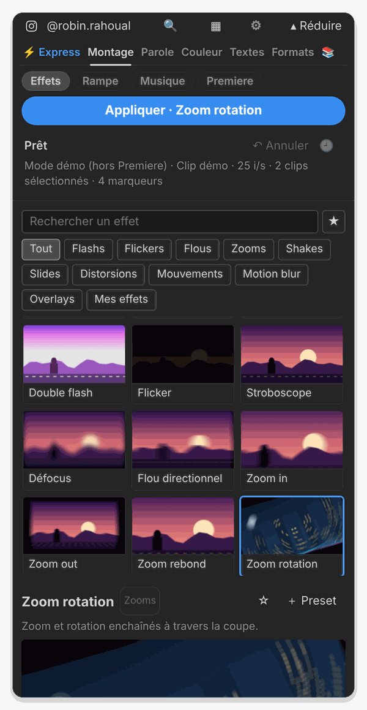 Choisis un effet et où le poser</td>
<td align="center" width="33%">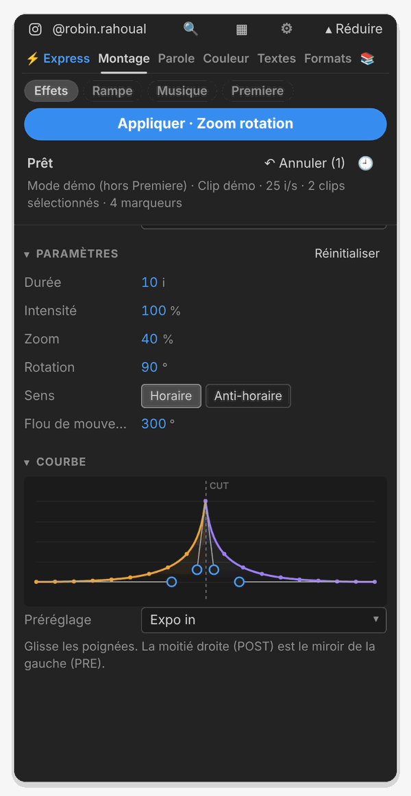 Règle-le, jusqu'à sa courbe</td>
<td align="center" width="33%">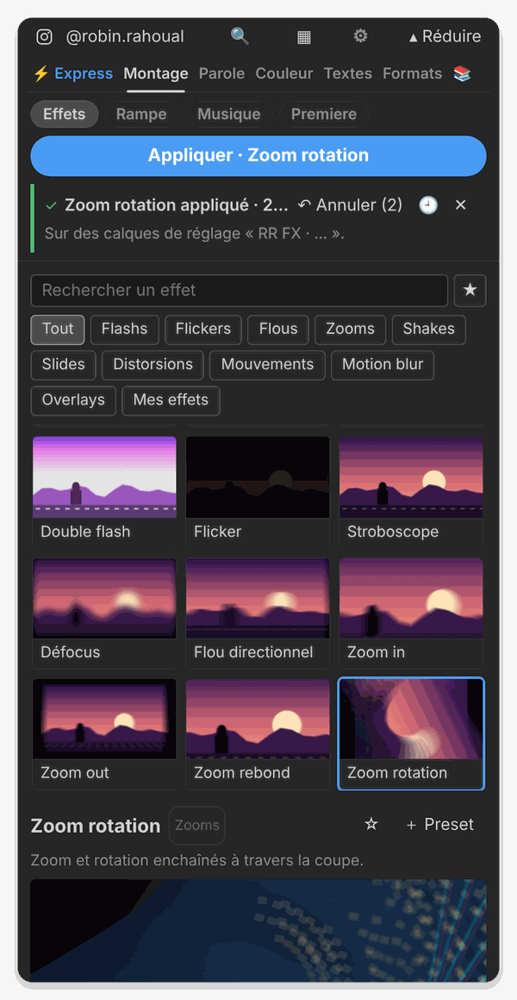 Posé sur toutes les coupes</td>
</tr>
</table>

### Un zoom qui suit un visage ou ton produit

- **Zoom visage** : RR FX trouve le visage dans chaque plan et zoome sur les yeux **en les suivant**. Parfait pour
  la face cam et les interviews.
- **Zoom suivi (objet)** : entoure un produit, un logo ou une personne sur la première image, RR FX le suit et zoome
  dessus. Idéal pour la pub, l'e-commerce et le sport.
- **Stabiliser le visage** : la tête reste au même endroit du cadre même si la personne bouge.

<table>
<tr>
<td align="center" width="50%"> Zoom visage et mouvements</td>
<td align="center" width="50%"> Entoure l'objet, RR FX le suit</td>
</tr>
</table>

### Les outils de Premiere, en un clic

> **Le problème :** Premiere sait faire un fondu enchaîné, un fondu audio ou une piste de sous-titres… mais une
> coupe à la fois.

L'onglet **Montage › Premiere** pilote les vrais outils de Premiere, partout d'un coup :

- **Transitions de Premiere** sur toutes les coupes ou celles de la sélection : fondu enchaîné, fondu au noir ou
  au blanc, fondu film, **Morph Cut** pour lisser un jump cut d'interview. Avant, centrées ou après la coupe.
- **Fondus audio anti-clic** : 2 images de puissance constante sur chaque coupe, idéal après la coupe des silences.
- **Changements de plan** : la détection de Premiere coupe une vidéo déjà montée, ou pose un marqueur à chaque plan.
- **Sous-titres de Premiere** : ton `.srt` (corrigé, traduit, recalé sur tes coupes) devient une vraie piste de
  sous-titres, à retoucher dans le panneau Texte de Premiere.
- ✅ Ce sont des transitions et des pistes de Premiere : tu les modifies comme si tu les avais posées à la main, et
  **↶ Annuler** retire les transitions.

<table>
<tr>
<td align="center" width="33%">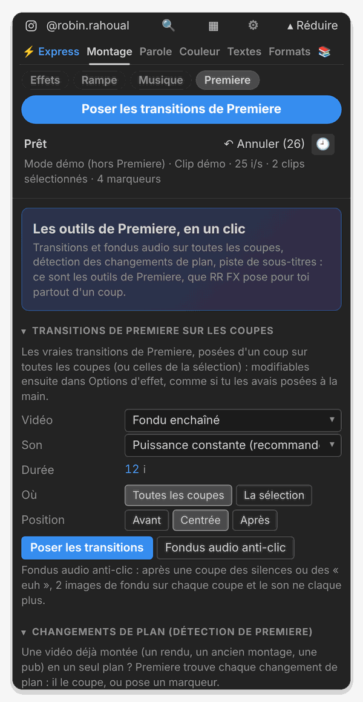 Choisis la transition et le fondu audio</td>
<td align="center" width="33%">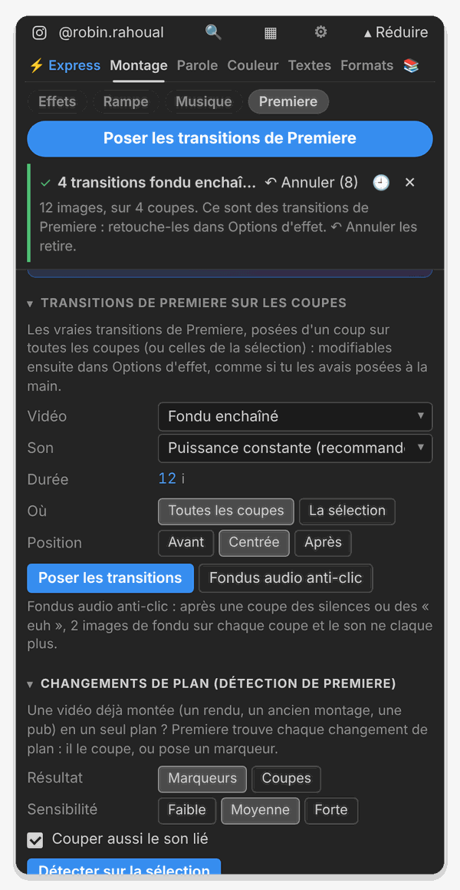 Posées sur toutes les coupes</td>
<td align="center" width="33%">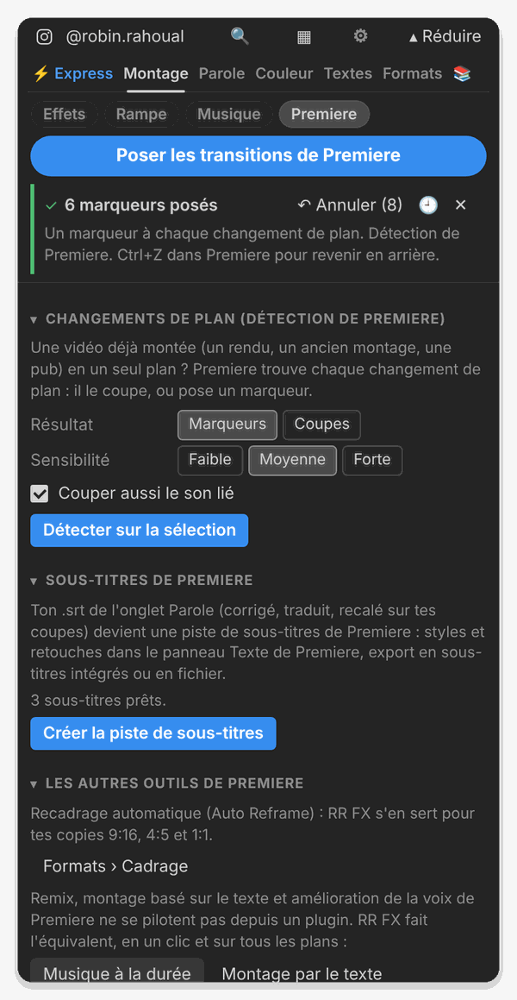 Changements de plan et sous-titres</td>
</tr>
</table>

### Overlays prêts à poser

**16 overlays fournis** : light leaks, flares, bokeh, pellicule, VHS, glitch. Rien à télécharger. Ajoute aussi tes
propres vidéos ou un dossier entier : ils sont posés sur tes coupes avec un fondu et le bon mode de fusion,
différents à chaque coupe.

### Des speed ramps qui ne cassent pas ta coupe

Dessine ta courbe de vitesse (de 10 % à 1000 %) ou pars d'une des **20 rampes prédéfinies** : coup de fouet,
claque sur la coupe, quasi-arrêt, double pulsation, timelapse…

- ✅ **Ta coupe reste à sa place**, ton son aussi.
- ✅ La durée se cale sur le tempo : ½, 1, 2 ou 4 temps.
- ✅ Tes rampes s'enregistrent, s'exportent et s'importent.

<table>
<tr>
<td align="center" width="33%"> 20 rampes rangées par usage</td>
<td align="center" width="33%"> Ta courbe de vitesse</td>
<td align="center" width="33%">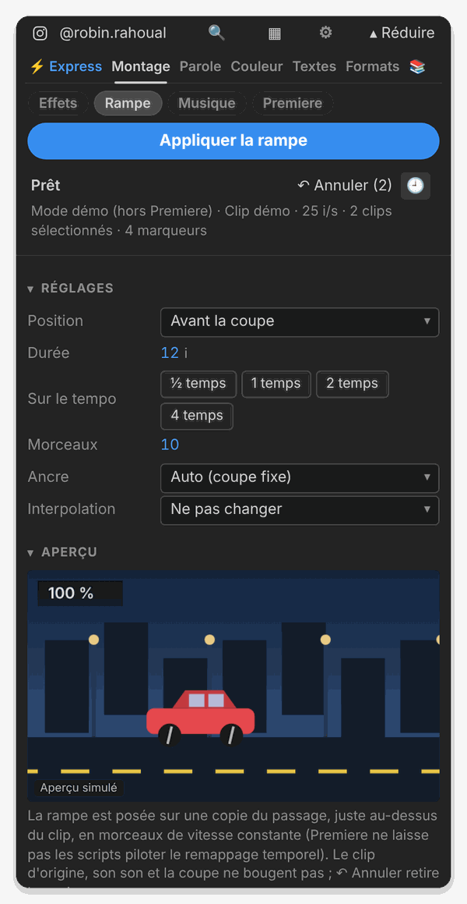 Calée sur le tempo, avec aperçu</td>
</tr>
</table>

<a href="#sommaire">⬆ Sommaire</a>

---

## 🎨 Couleur

### L'étalonnage comme dans Lightroom

Les mêmes panneaux que Lightroom : réglages de base, courbe des tonalités, mélangeur de couleurs, roues
d'étalonnage, calibrage. Des **looks** prêts à l'emploi et un **avant / après sur ta vraie image**.

- ✅ Un clic pour l'appliquer dans Premiere.
- ✅ Exporte aussi en **LUT .cube** ou en **DCTL pour DaVinci Resolve**.

<table>
<tr>
<td align="center" width="33%"> Avant / après sur ton image</td>
<td align="center" width="33%">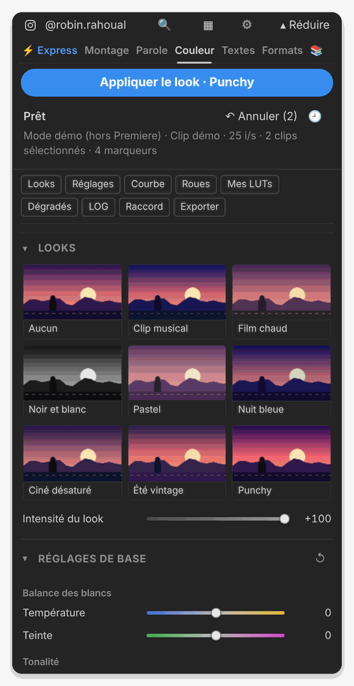 Des looks en un clic</td>
<td align="center" width="33%">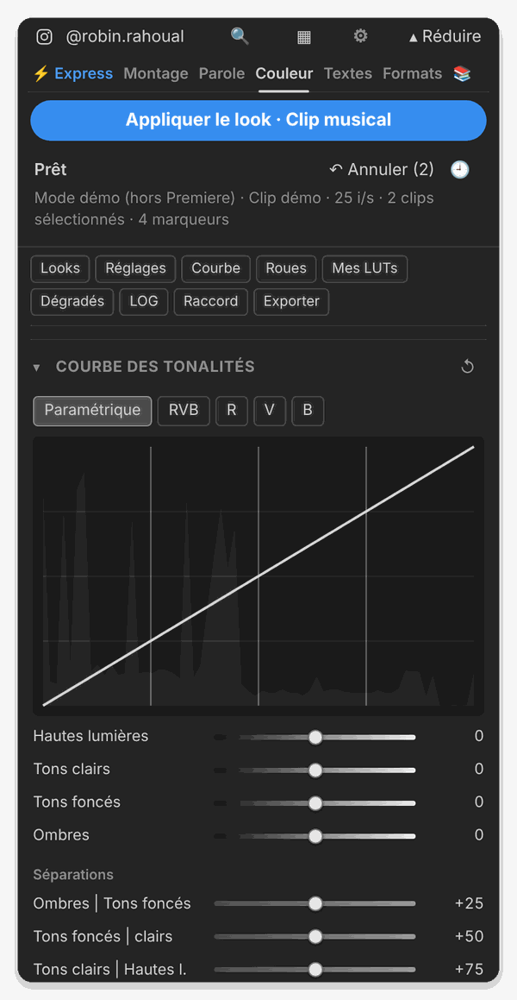 Courbe des tonalités</td>
</tr>
<tr>
<td align="center">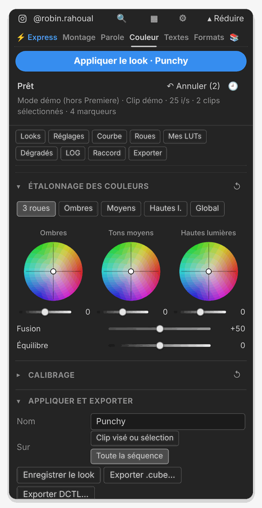 Roues d'étalonnage</td>
<td align="center">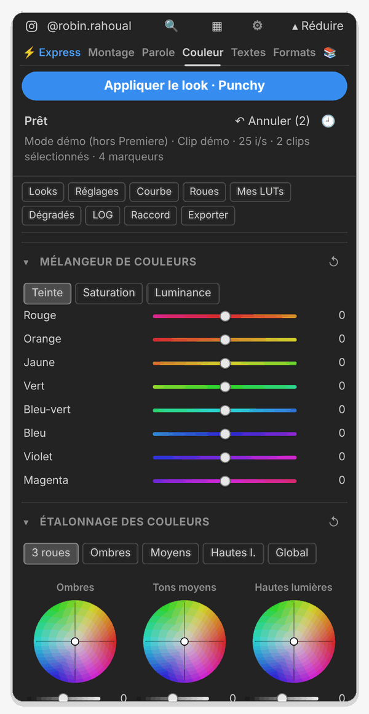 Mélangeur de couleurs</td>
<td align="center"> Dégradés de couleur (CSS, Figma…)</td>
</tr>
</table>

### Du LOG au Rec.709 en un clic

> **Le problème :** charger la bonne LUT sur chaque rush, caméra par caméra.

Tu filmes en S-Log3, V-Log, C-Log, F-Log, D-Log ou Apple Log ? **Enregistre ta caméra une fois**, pour tous tes
projets. Un clic pose un calque Lumetri au-dessus de tous tes rushs, **la LUT déjà chargée**.

- ✅ Plusieurs caméras ? RR FX **reconnaît la caméra de chaque plan** et met la bonne LUT.
- ✅ La LUT de ton fabricant, ou une LUT calculée par RR FX.

<table>
<tr>
<td align="center" width="50%"> Tes caméras enregistrées</td>
<td align="center" width="50%">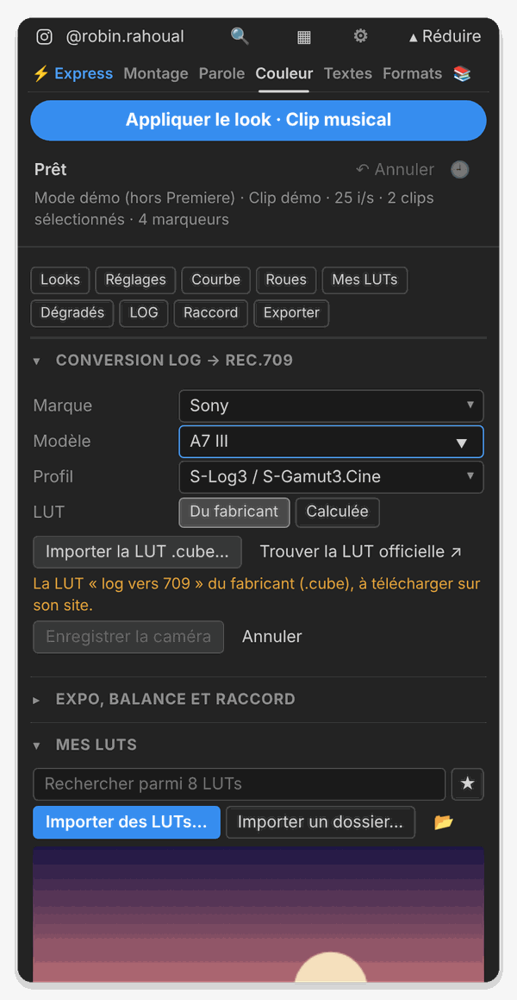 Une caméra ajoutée en trois choix</td>
</tr>
</table>

### Expo auto et raccord entre caméras

- **Expo et balance des blancs auto** : chaque plan est analysé et corrigé, avec mesure.
- **Raccord** : ton iPhone prend le rendu de ton boîtier. Prends un plan de référence, sélectionne les plans à
  raccorder, c'est fait, avec un avant / après.
- **Ou une image de référence** : une capture d'un film ou d'un Reel que tu aimes, et tes plans prennent ses
  couleurs.

<table>
<tr>
<td align="center" width="50%"> Raccord sur un plan de ta séquence</td>
<td align="center" width="50%">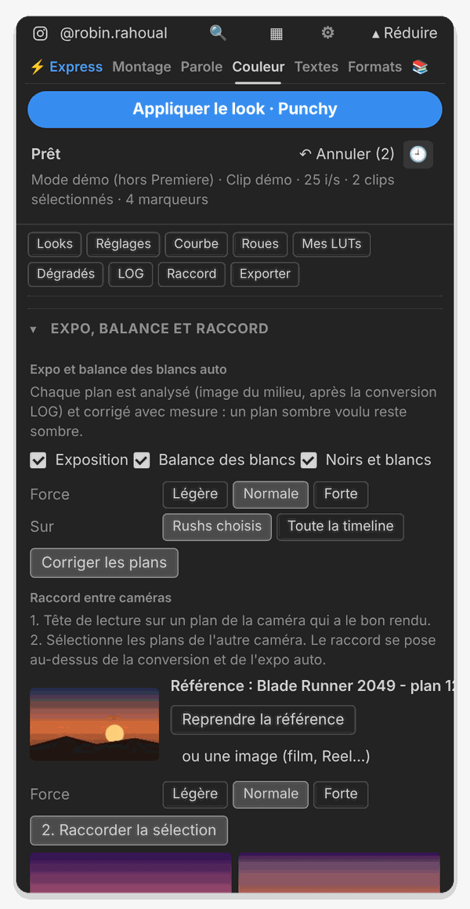 Ou sur l'image d'un film</td>
</tr>
</table>

### Toutes tes LUTs, dans tous tes projets

Fini de réimporter tes LUTs à chaque projet. **Importe-les une fois** (.cube, .3dl, .look… ou un dossier entier) :
**une vignette par LUT sur ta vraie image**, recherche, favorites, et un double-clic pour la poser.

<table>
<tr>
<td align="center" width="50%"> Tes LUTs sur ton image</td>
<td align="center" width="50%"> Essaie une LUT de tes dossiers</td>
</tr>
</table>

<a href="#sommaire">⬆ Sommaire</a>

---

## 🔤 Textes et habillage

### Titres et paroles animés

Colle tes textes ou tes paroles : **une ligne par temps fort**, par marqueur ou à durée fixe, animée (Pop, Zoom,
Glissement, Impact…), avec ta police et ton modèle `.mogrt`.

### Tes styles de texte et les couleurs de ta marque

Crée tes **styles de texte** une fois (police, taille, couleur, contour, ombre, fond, majuscules) : ils servent
partout, titres, sous-titres, bandeaux. **Mes couleurs** garde la palette de ta marque : colle des codes, un lien
Coolors, ou importe un **nuancier Adobe (.ase)**.

### Barre de progression et compte à rebours

Une **barre qui avance** jusqu'à la fin de la vidéo (les gens voient combien il reste et restent jusqu'au bout), et
un **compte à rebours** de 3, 5 ou 10 s.

<table>
<tr>
<td align="center" width="33%"> Paroles animées sur le rythme</td>
<td align="center" width="33%"> Ton style de texte, aperçu direct</td>
<td align="center" width="33%"> Barre de progression, compte à rebours</td>
</tr>
</table>

<a href="#sommaire">⬆ Sommaire</a>

---

## 📱 Formats et livraison

### Prêt pour Reels, TikTok et LinkedIn

> **Le problème :** recadrer chaque plan à la main pour la version verticale.

Une **copie de ta séquence en 9:16** (ou 4:5, 1:1) en un clic, ta séquence d'origine ne bouge pas.

- **Recadrage automatique** de Premiere, qui suit ton sujet ;
- ou **en suivant le visage** : RR FX garde la personne au centre, plan par plan ;
- ou **sur fond flou** : le plan entier au centre, sur lui-même agrandi et flouté.
- ✅ L'aperçu montre la **zone sûre**, ce que cachent les boutons de l'app.

<table>
<tr>
<td align="center" width="33%">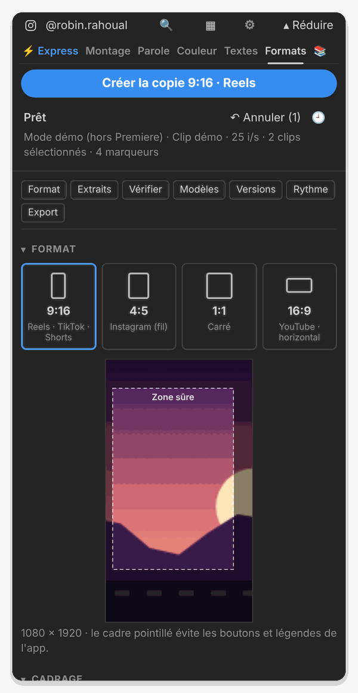 9:16, 4:5, 1:1 ou 16:9</td>
<td align="center" width="33%"> Le cadre suit le visage</td>
<td align="center" width="33%">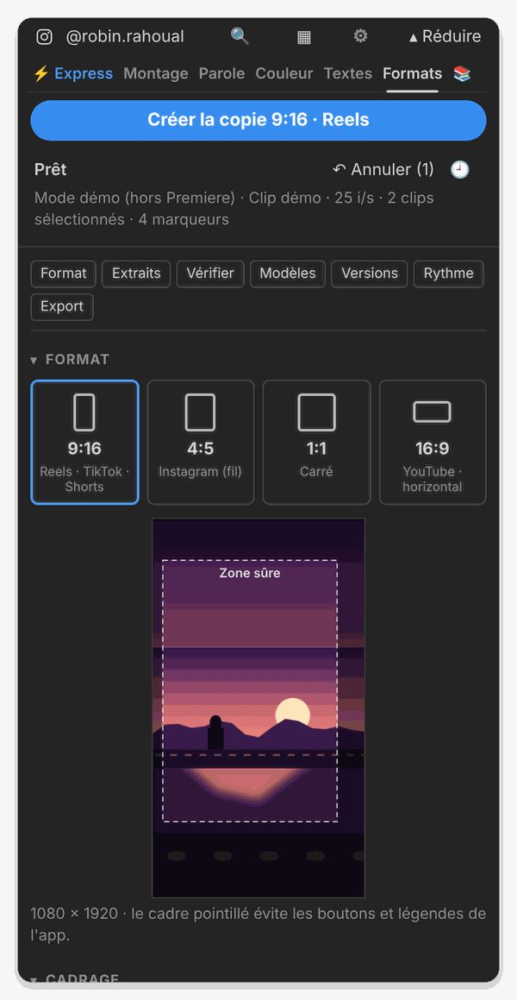 Ou sur fond flou</td>
</tr>
</table>

### Des extraits prêts pour les réseaux

Une interview, un podcast ou un live d'une heure ? RR FX trouve **les meilleurs passages** (on parle sans blanc, la
voix vit, les mots forts du `.srt`), chacun commence et finit sur une phrase. Une séquence par extrait, au format
choisi, avec ses sous-titres.

<table>
<tr>
<td align="center" width="50%"> Les meilleurs passages, à écouter</td>
<td align="center" width="50%">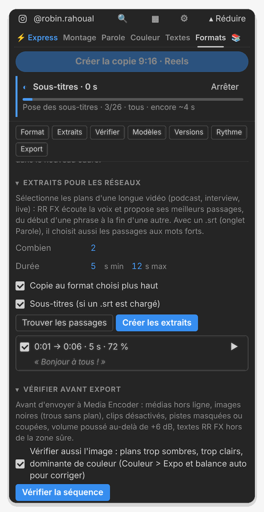 Une séquence par extrait</td>
</tr>
</table>

### Vérifié avant d'exporter

> **Le problème :** découvrir un média hors ligne ou une image noire… après l'export.

Un clic, et RR FX liste ce qui cloche : **médias hors ligne**, **images noires**, clips **désactivés**, **texte
hors zone sûre**, **volume poussé**, et les **plans trop sombres, trop clairs ou avec une dominante**. Clique sur
une ligne, la tête de lecture y va. Et la même action peut passer **sur plusieurs séquences** d'un coup.

<table>
<tr>
<td align="center" width="50%"> Rouge : à corriger, orange : à regarder</td>
<td align="center" width="50%">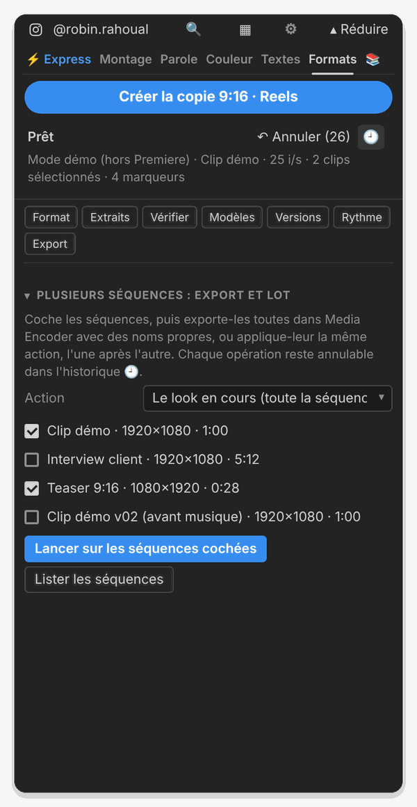 Une action sur plusieurs séquences</td>
</tr>
</table>

### Le rythme de ton montage, d'un coup d'œil

La durée de **chaque plan** en un graphique : les plans trop longs ressortent en orange, là où l'attention
décroche. Un clic y amène la tête de lecture, ou pose un marqueur sur chacun.

<table>
<tr>
<td align="center" width="50%">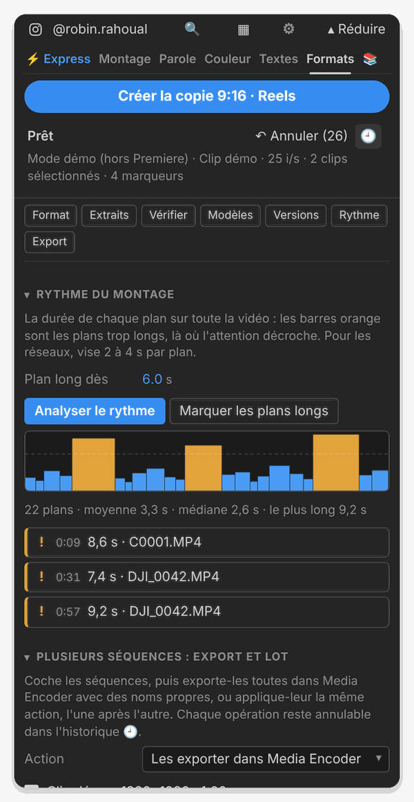 Les plans trop longs en orange</td>
<td align="center" width="50%">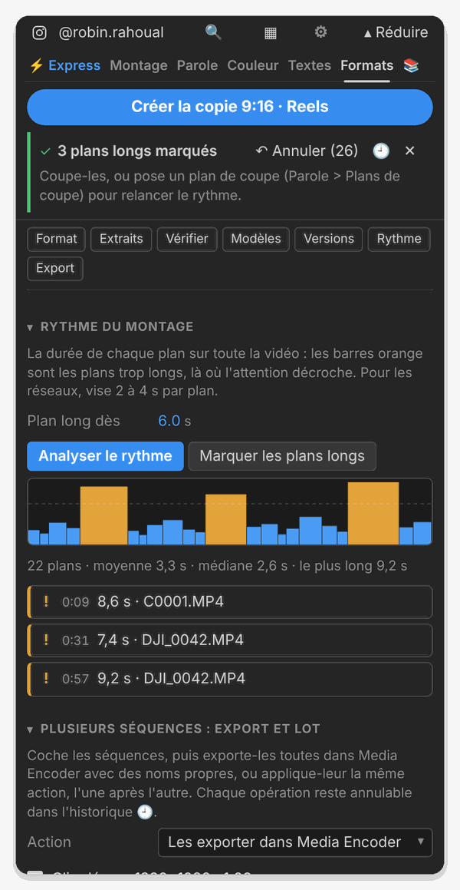 Un marqueur sur chacun</td>
</tr>
</table>

### Exporter, versionner, archiver

- **Export en lot** : coche tes séquences, chacune part dans **Media Encoder** avec un nom propre
  (`Nike_Clip_9x16_v03`). Le numéro de version avance tout seul.
- **Versions de la séquence** : une copie figée en un clic avant les retours du client, rangée dans *Versions*.
- **Archiver le projet** : un dossier avec seulement les médias utilisés, une copie du projet et un récapitulatif.

<table>
<tr>
<td align="center" width="33%">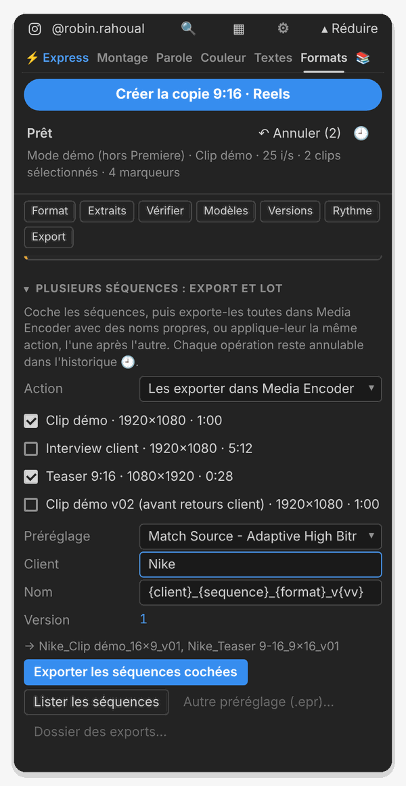 Tout exporter d'un coup</td>
<td align="center" width="33%"> Une version avant chaque gros changement</td>
<td align="center" width="33%">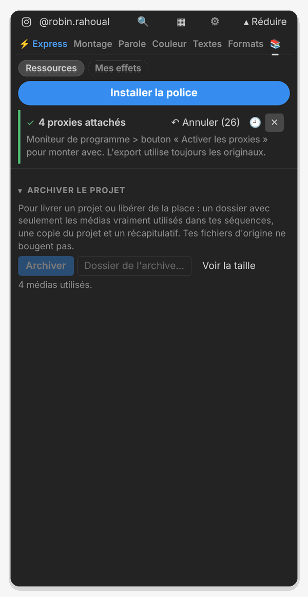 Une archive avec les seuls médias utilisés</td>
</tr>
</table>

<a href="#sommaire">⬆ Sommaire</a>

---

## 🗂️ Projet et ressources

### Toutes tes ressources à portée de clic

Lie le dossier où tu ranges tes **SFX, LUTs, polices, overlays et titres** : tout est classé dans le panneau.
Écoute un son, essaie une LUT sur ton image, vois une police avant de l'installer, pose un whoosh sur chaque coupe.
Et **importe une vidéo ou un son depuis un lien** (direct, Dropbox, Google Drive, ou YouTube avec yt-dlp).

<table>
<tr>
<td align="center" width="33%">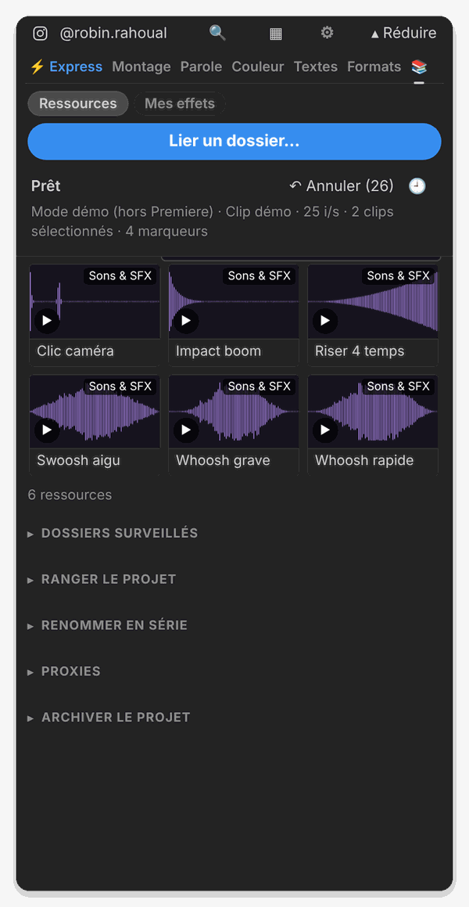 Tes sons, à écouter</td>
<td align="center" width="33%">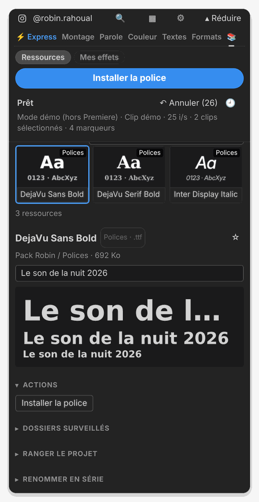 Tes polices, à voir</td>
<td align="center" width="33%"> Une vidéo depuis un lien</td>
</tr>
</table>

### Un projet propre sans y penser

- **Dossiers surveillés** : les nouveaux fichiers d'un dossier (carte mémoire copiée, dossier partagé avec un client)
  arrivent **tout seuls dans un chutier**.
- **Ranger le projet** : ce qui traîne part dans des chutiers par type, les médias jamais utilisés à part. Rien
  n'est supprimé.
- **Renommer en série** : `Interview_###` → Interview_001, Interview_002…, avec un aperçu.
- **Proxies en un clic** : Media Encoder fabrique des proxies légers, RR FX les attache tout seul.

<table>
<tr>
<td align="center" width="33%">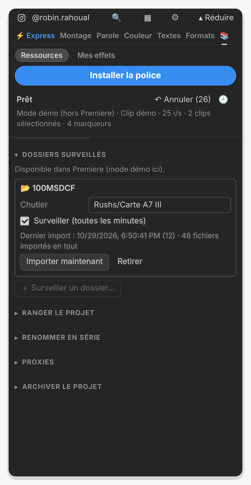 Import automatique</td>
<td align="center" width="33%"> Rangement et renommage</td>
<td align="center" width="33%">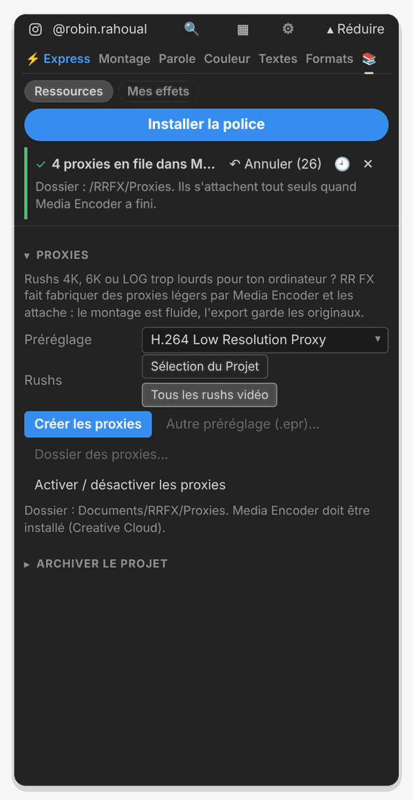 Proxies attachés au fur et à mesure</td>
</tr>
</table>

### Ton style, réutilisable et partageable

- **Capture** n'importe quel effet monté dans Premiere (effets tiers compris) et réutilise-le en un clic.
- **Packs de style** : tes effets, looks, textes et overlays dans un seul fichier, pour un autre projet ou un pote.
- **La bibliothèque de la communauté** : les effets publiés par les autres monteurs, à ajouter en un clic.

<table>
<tr>
<td align="center" width="50%"> Ta bibliothèque</td>
<td align="center" width="50%"> Les effets de la communauté</td>
</tr>
</table>

<a href="#sommaire">⬆ Sommaire</a>

---

## 🚀 Ton flux de travail

### Ton panneau, à ta façon

> **Le problème :** 50 outils, alors que tu en utilises 10.

- **Onglets regroupés** : *Montage* (Effets, Rampe, Musique, Premiere) et *📚 Bibliothèque* (Ressources, Mes effets)
  ouvrent leurs sous-onglets ; tout tient sur une ligne.
- **▦ Fenêtres**, comme dans Premiere : affiche ou masque chaque onglet et chaque outil. Un outil masqué reste à un
  Ctrl+K, un raccourci ou une macro.
- **Espaces de travail** : *Essentiel*, *Interview et YouTube*, *Réseaux sociaux*, *Clip et événement*, ou le tien.
- **Réglages rangés par thème** : Général, Contrôle, Temps, Projet, Plus.

<table>
<tr>
<td align="center" width="33%">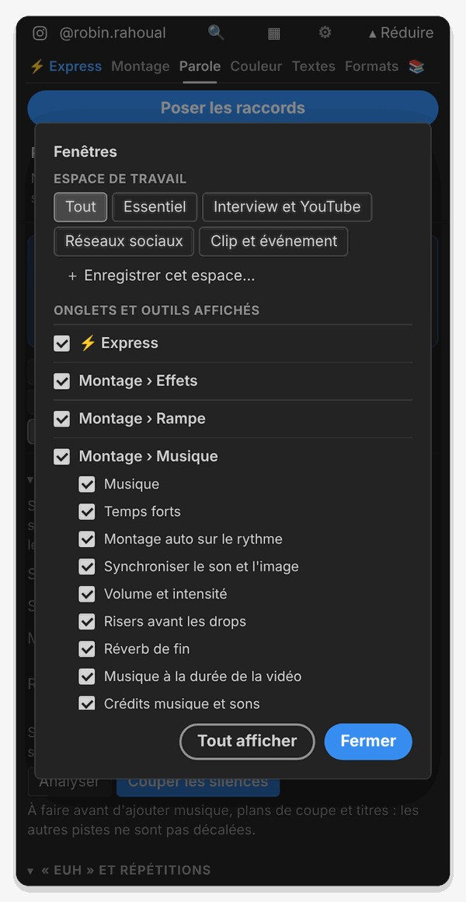 Fenêtres et espaces de travail</td>
<td align="center" width="33%"> Seulement les outils de l'espace</td>
<td align="center" width="33%"> Réglages rangés par thème</td>
</tr>
</table>

### Macros : tes enchaînements sur un seul bouton

Enchaîne plusieurs actions RR FX et lance-les **d'un seul clic** : couper les silences, couper les « euh »,
égaliser la voix, poser les sous-titres, vérifier avant export. Sur une touche, dans la recherche rapide ou sur un
bouton de Stream Deck.

<table>
<tr>
<td align="center" width="50%"> Deux exemples prêts</td>
<td align="center" width="50%"> Ta macro en quelques clics</td>
</tr>
</table>

### Tout au clavier, au Stream Deck, et sur tous tes ordinateurs

- **Ctrl+K** (ou **/**) : tape deux lettres, appuie sur Entrée. Une action, un effet, un look : tout se trouve.
- **Un raccourci pour chacune des 45 actions**, à ta façon.
- **Télécommande** : chaque action sur un bouton de **Stream Deck** ou de Companion.
- **Synchro entre ordinateurs** par Dropbox, iCloud Drive, OneDrive ou Google Drive : tes effets, looks et
  réglages te suivent. Aucun compte.
- **Historique** : chaque opération avec son heure, et **Annuler** celle que tu veux, même ancienne.

<table>
<tr>
<td align="center" width="33%"> Ctrl+K : tout au clavier</td>
<td align="center" width="33%"> Stream Deck et Companion</td>
<td align="center" width="33%"> Un historique pour tout annuler</td>
</tr>
<tr>
<td align="center"> Une touche par action</td>
<td align="center"> Tes réglages sur tous tes ordinateurs</td>
<td align="center"> En français ou en anglais</td>
</tr>
</table>

### Le temps gagné, le temps passé

- **Temps gagné avec RR FX** : chaque opération ajoute ce qu'elle aurait pris à la main (estimation prudente), et
  une **carte à partager** en story.
- **Badges** : 1 h, 10 h, 100 h gagnées, 100 opérations, 15 outils différents…
- **Temps passé par projet**, ton tarif horaire et un **export CSV** pour facturer. Rien ne quitte ton ordinateur.
- **Astuce du jour** (à activer dans Réglages) : un outil que tu n'as pas encore essayé, avec *Voir* pour y aller.

<table>
<tr>
<td align="center" width="33%"> Le temps que RR FX t'a fait gagner</td>
<td align="center" width="33%"> Badges et astuce du jour</td>
<td align="center" width="33%"> Le temps passé, prêt à facturer</td>
</tr>
</table>

### Pris en main en 30 secondes, à jour en un clic

- À la première ouverture, tu choisis ta langue, puis un **accueil** te montre par où commencer.
- **Test de compatibilité** : un clic, et RR FX vérifie sur une copie de ta séquence tout ce dont il a besoin
  dans ton Premiere.
- Quand une nouvelle version sort : **Installer la mise à jour**, directement dans le panneau. Le pack est
  **signé** et vérifié, ta version actuelle est gardée de côté, et rien ne change si quelque chose se passe mal.

<table>
<tr>
<td align="center" width="33%"> Un accueil pour démarrer</td>
<td align="center" width="33%"> Tu sais que ça marche chez toi</td>
<td align="center" width="33%"> <i>Also in English</i></td>
</tr>
</table>

<a href="#sommaire">⬆ Sommaire</a>

---

## Installer RR FX en 3 étapes

1. **[Télécharge RR FX](https://github.com/RobinRahoual/RRFX/releases/latest)** (fichier
   `RRFX-…-installation.zip`, section *Assets*) et décompresse-le.
2. Ferme Premiere Pro, puis lance l'installateur :
   - **Windows** : double-clique sur `Installer RR FX (Windows).bat`.
     Si Windows affiche « Windows a protégé votre ordinateur » : *Informations complémentaires* > *Exécuter quand même*.
   - **Mac** : clic droit sur `Installer RR FX (Mac).command` > *Ouvrir*.
3. Ouvre Premiere : **Fenêtre > Extensions > RR FX**.

> **Une seule chose à faire par projet** : crée un calque de réglage (*Fichier > Nouveau > Calque de réglage*).
> RR FX le retrouve tout seul.

  

---

## Questions fréquentes

<b>C'est vraiment gratuit ?</b>

Oui. Pas d'abonnement, pas de compte, pas de publicité.

<b>Ça marche avec ma version de Premiere ?</b>

Premiere Pro 2021 à 2026, sur Windows et sur Mac, quelle que soit la langue de Premiere (RR FX retrouve tout seul
le nom des effets). Pour en être sûr : *Réglages > Test de compatibilité*, un clic.

<b>Est-ce que RR FX modifie mes clips ?</b>

Non. Les effets se posent sur des calques au-dessus de tes plans (nommés `RR FX · …`). Seules les speed ramps et le
motion blur travaillent sur une copie du passage, posée au-dessus. **↶ Annuler** retire la dernière opération et
*Tout effacer* retire tout ce que RR FX a posé.

<b>Et la coupe des silences, je peux revenir en arrière ?</b>

Oui. Par défaut, elle se fait sur une **copie** de ta séquence (« … (sans silences) ») : l'originale reste
intacte. Tu peux aussi couper directement dans la séquence (Ctrl+Z dans Premiere pour revenir) ou seulement poser
un marqueur sur chaque silence. Fais-la avant d'ajouter musique, plans de coupe et titres : seules les pistes des
plans choisis sont recollées.

<b>Il faut une musique ?</b>

Seulement pour ce qui suit le rythme (temps forts, montage auto, paroles). Les styles Interview, Entreprise, Face
cam et YouTube marchent sans musique : leurs transitions se posent sur toutes les coupes de la séquence.

<b>Comment je mets à jour ?</b>

RR FX te prévient quand une nouvelle version sort : clique sur **Installer la mise à jour** dans le panneau, puis
redémarre Premiere. Tes effets perso et tes réglages sont gardés.

<b>L'import depuis YouTube, comment ça marche ?</b>

RR FX passe par [yt-dlp](https://github.com/yt-dlp/yt-dlp), un outil gratuit et open source que tu installes une
fois (`winget install yt-dlp` sur Windows, `brew install yt-dlp` sur Mac) : RR FX ne l'embarque pas. Avec
[ffmpeg](https://ffmpeg.org) installé aussi, les sons sortent en MP3 (sinon en M4A, que Premiere lit aussi). Les
fichiers vont dans `Documents/RRFX/Téléchargements`. Réserve-le aux contenus dont tu as les droits : télécharger
une vidéo YouTube sans autorisation est contraire à ses conditions d'utilisation.

<b>Je peux l'essayer sans Premiere ?</b>

Oui : ouvre `plugin/index.html` dans ton navigateur, le panneau tourne en mode démo avec des images d'exemple.

<b>Quelque chose ne marche pas ?</b>

Clique sur **Voir le détail** sous le message du panneau : il dit ce qui a bloqué. Lance aussi le **test de
compatibilité** (Réglages) et copie le rapport. Envoie-le moi sur
[Instagram](https://www.instagram.com/robin.rahoual/) ou ouvre une
[issue](https://github.com/RobinRahoual/RRFX/issues).

<b>Je veux tous les détails</b>

Le [guide complet](docs/GUIDE.md) explique chaque réglage, onglet par onglet. Les notes techniques (tests,
publication, code) sont dans [DEVELOPPEMENT.md](docs/DEVELOPPEMENT.md).

---

<b>Prêt à gagner du temps sur ton prochain montage ?</b>

  

Plugin gratuit créé par <b>Robin Rahoual</b> 
Suis-moi sur Instagram pour les astuces et les nouveautés : <a href="https://www.instagram.com/robin.rahoual/">@robin.rahoual</a>

