
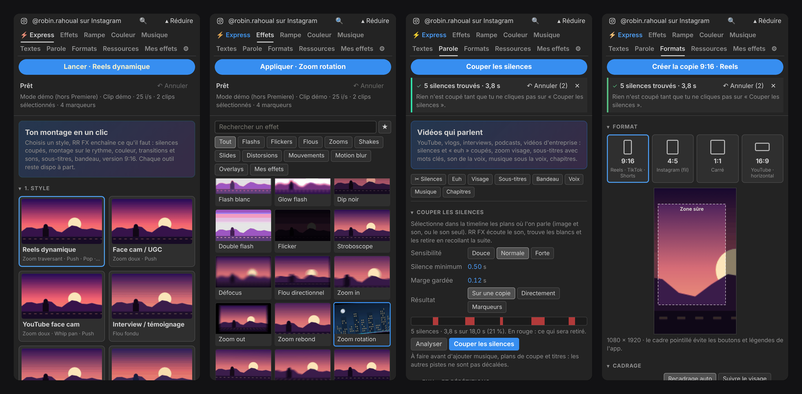

<h1 align="center">RR FX</h1>

<b>Le couteau suisse gratuit du montage dans Premiere Pro.</b> 
Transitions et mouvements, silences coupés, sous-titres, couleur, sons, formats réseaux : tout ce qui fait gagner du temps, 
pour n'importe quelle vidéo. Un style en un clic, ou chaque outil séparément.

  

  
  
  
  

---

## Pourquoi RR FX ?

- **🧰 Un couteau suisse.** Les mêmes outils servent partout : un Reel, une interview, une vidéo d'entreprise, un
  aftermovie, un vlog YouTube ou un clip. Rien n'est rangé par métier, tout est à portée de clic.
- **⚡ Ton montage en un clic.** Le mode Express enchaîne tout : de la coupe des silences ou du premier temps fort
  jusqu'à la version Reels.
- **🎯 Précis.** Chaque effet est posé sur ta coupe, tes marqueurs ou chaque temps fort de la musique, avec son son.
- **🛡️ Ton montage ne bouge pas.** Les effets se posent sur des calques au-dessus de tes plans. Tes clips, ton son
  et tes coupes ne sont jamais modifiés, et **↶ Annuler** retire tout.
- **🧰 Tout au même endroit.** Transitions, mouvements, rampes, couleur, musique, parole, textes, formats et tes
  propres ressources : un seul panneau dans Premiere.
- **🧪 Fiable.** Un test de compatibilité vérifie ton Premiere en un clic, et les mises à jour s'installent toutes
  seules.
- **🎁 Gratuit.** Pas d'abonnement, pas de compte.

---

## Ce que tu peux faire

<table>
<tr>
<td width="56%">

### ⚡ Express : ton montage en un clic

Choisis un style, clique. RR FX enchaîne **dans l'ordre** les étapes de ce style :

1. coupe les silences (sur une copie de ta séquence) ou pose les temps forts de ta musique ;
2. monte tes rushs sur le rythme ;
3. convertit ton LOG en Rec.709, corrige l'expo, pose le look ;
4. zoome un plan sur deux sur les jump cuts, pose les transitions **et leurs sons** sur chaque coupe ;
5. pose les sous-titres, le bandeau nom et fonction ou les paroles, puis la version 9:16.

Pas de musique pour une interview ? Pas de souci : seules les étapes utiles sont proposées. Tout reste
modifiable, et **↶ Annuler** retire une étape à la fois.

</td>
<td width="44%">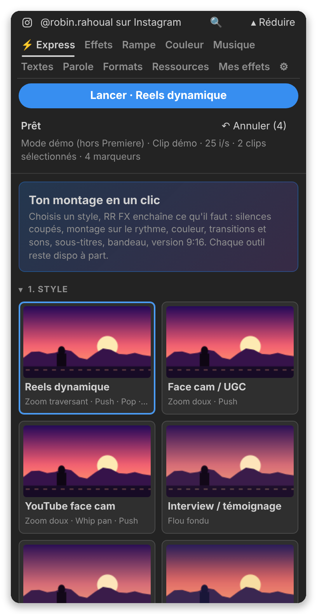</td>
</tr>
<tr>
<td width="44%">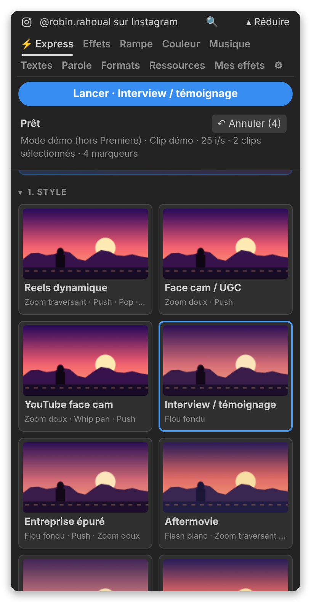</td>
<td width="56%">

### 🎬 14 styles prêts à l'emploi

**Reels dynamique**, **Face cam / UGC**, **YouTube face cam**, **Interview / témoignage**, **Entreprise épuré**,
**Aftermovie**, **Mariage / cérémonie**, **Vlog voyage**, **Cinématique**, **Rap énergique**, **Drill sombre**,
**Pop lumineux**, **Chill / lofi**, **Rétro VHS**… ou **ton style** à toi. Ce sont des points de départ : prends
celui qui colle à ta vidéo, décoche les étapes inutiles.

Chaque style règle tout : les étapes, le rythme des plans, les transitions, le look, les sons et l'animation des
textes. Un compte rendu clair à la fin : ce qui a été fait, étape par étape.

</td>
</tr>
<tr>
<td width="56%">

### ⚡ Transitions et effets en un clic

**36 effets** prêts à l'emploi, pour toutes tes vidéos :

- **Transitions modernes** : push, zoom lent, zoom traversant, pop, fondus au blanc et au noir, fondu flou.
- **Zoom visage** : RR FX trouve le visage dans chaque plan et zoome sur les yeux **en les suivant** (+20 % par
  défaut). Les yeux restent à leur place à l'écran, ou sont recentrés : parfait pour la face cam et les interviews.
  En coupe sèche, en arrivée douce ou en zoom progressif.
- **Stabiliser le visage** : la tête reste au même endroit du cadre même si la personne bouge.
- **Zoom suivi (objet)** : entoure un produit, un logo ou une personne sur la première image, RR FX le suit et
  zoome dessus.
- **Mouvements** sur tout le plan : Ken Burns (photos d'événement), zoom lent, caméra à l'épaule, punch-in.
- **Effets de clip** : flashs, flickers, zooms, shakes, glitchs, motion blur.

Survole une vignette pour la voir bouger. Pose l'effet sur **la coupe**, **toutes les coupes de la séquence**,
**tes marqueurs**, **chaque temps fort** ou **tous les plans**.
- **Les sons avec** : whooshs et impacts fournis, calés pile sur chaque coupe.
- Tout reste modifiable ensuite dans *Options d'effet*, comme si tu l'avais fait à la main.

</td>
<td width="44%">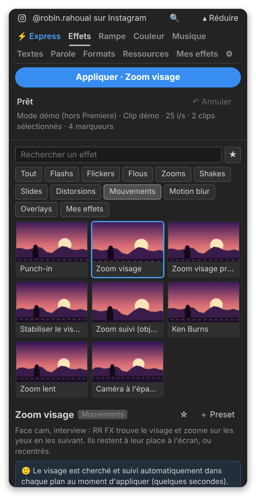</td>
</tr>
<tr>
<td width="44%">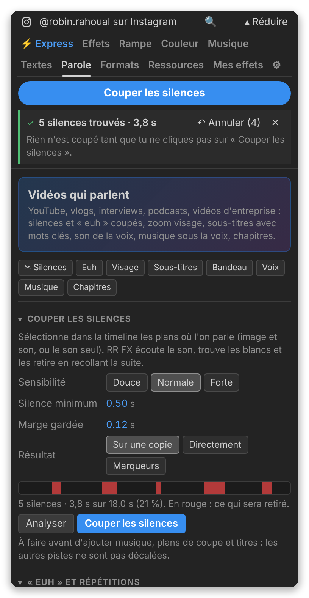</td>
<td width="56%">

### 🎙️ Couper les silences en un clic

Pour YouTube, les vlogs, les interviews et les podcasts filmés. Sélectionne tes plans, clique **Analyser** :
RR FX écoute le son et te montre les blancs en rouge, avant de toucher à quoi que ce soit.

- **Couper** : les blancs sont retirés, l'image et le son recollés et toujours synchro.
- Par défaut sur **une copie** de ta séquence : l'originale reste intacte. Ou juste un marqueur sur chaque silence.
- Sensibilité, silence minimum et marge autour des mots réglables.
- Puis **Zoom visage** : un plan sur deux resserré sur les yeux, chaque jump cut devient un changement de cadre.
- L'onglet Parole a son **sommaire** : un clic amène à l'outil voulu, et le bouton bleu reprend le dernier utilisé.

</td>
</tr>
<tr>
<td width="56%">

### ✂️ Les « euh » en moins

RR FX repère dans le son les **« euh », « hum » et hésitations** (une voyelle tenue entre deux pauses), et dans
ton `.srt` les **répétitions** (« on va, on va ») et les **faux départs**.

- Coupés sur une copie de ta séquence, directement, ou simplement **marqués** pour vérifier d'abord.
- Les sous-titres se recalent tout seuls sur chaque coupe.

</td>
<td width="44%">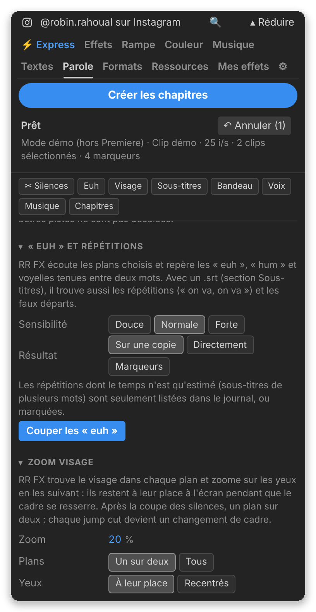</td>
</tr>
<tr>
<td width="44%">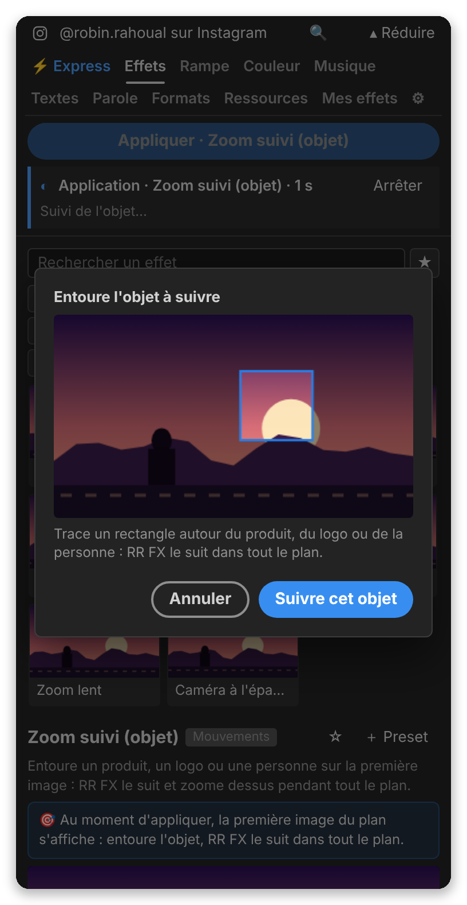</td>
<td width="56%">

### 🎯 Un zoom qui suit ton produit

**Zoom suivi (objet)** : entoure un produit, un logo ou une personne sur la première image du plan. RR FX le
retrouve image par image et zoome dessus pendant tout le plan.

- Idéal pour la pub, l'e-commerce, les démos et le sport.
- L'objet reste à sa place à l'écran, ou il est recentré. Arrivée douce ou sèche.
- **Stabiliser le visage** fait pareil avec une tête : elle ne bouge plus dans le cadre.

</td>
</tr>
<tr>
<td width="56%">

### 💬 Sous-titres, mots clés et bandeaux

- **Sous-titres** : importe un `.srt` (Premiere le crée avec sa transcription) et RR FX pose chaque phrase en texte
  animé. **Mot par mot** pour le style TikTok, ou 3 mots, ou la phrase entière. Recalés tout seuls après la coupe
  des silences et des « euh ».
- **Mots clés en couleur** : chiffres, mots forts et ta propre liste ressortent en jaune (ou la couleur de ton
  choix), avec un **emoji** et un petit **« pop » sonore** en option.
- **Bandeau nom et fonction** pour tes interviews et témoignages, en bas à gauche, animé.

</td>
<td width="44%">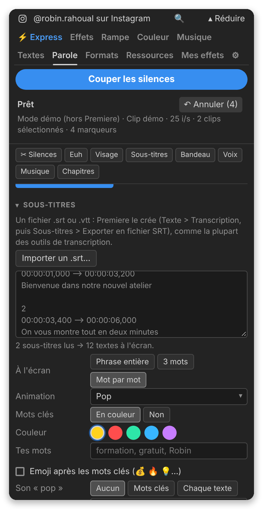</td>
</tr>
<tr>
<td width="44%">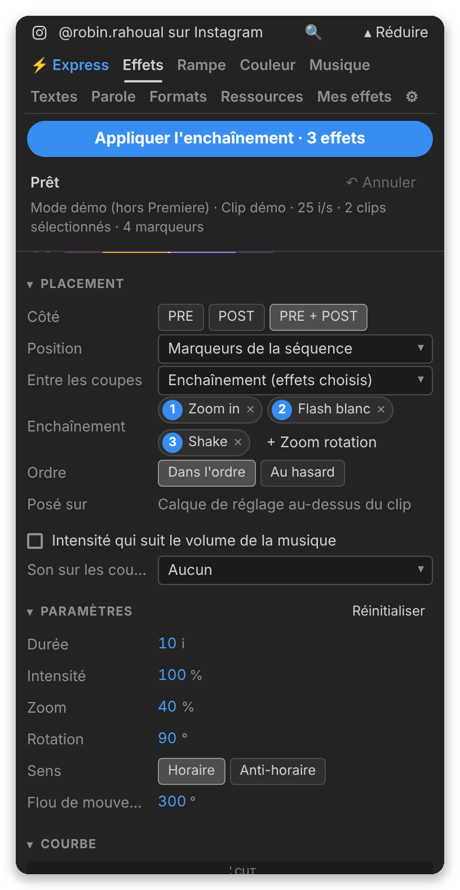</td>
<td width="56%">

### 🥁 Des effets qui suivent la musique

Choisis 2 à 4 effets (Maj + clic) : ils **s'enchaînent sur chaque temps fort**, dans l'ordre ou au hasard.

- Zoom sur le kick, flash sur la caisse claire, shake sur le drop.
- En option, **l'intensité suit le volume** : plus doux sur le couplet, plus fort sur le refrain.

</td>
</tr>
<tr>
<td width="56%">

### ✨ Overlays prêts à poser

**16 overlays fournis** : light leaks, flares, bokeh, pellicule, VHS, glitch. Rien à télécharger.

- Ajoute aussi tes propres vidéos et images, ou un dossier entier.
- Posés sur tes coupes avec un fondu et le bon mode de fusion, différents à chaque coupe.

</td>
<td width="44%">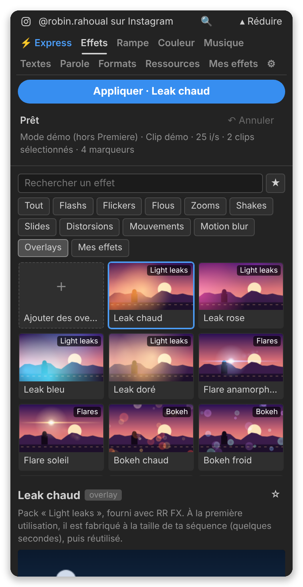</td>
</tr>
<tr>
<td width="44%">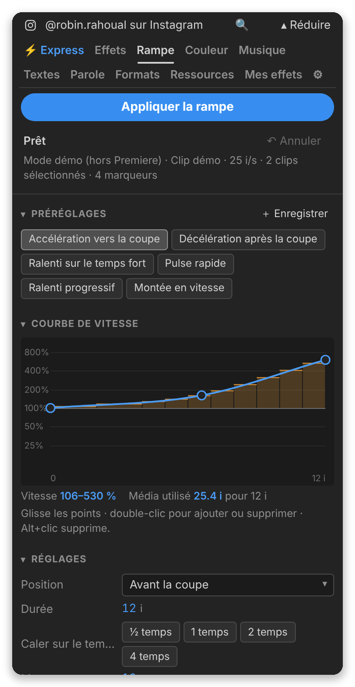</td>
<td width="56%">

### 🏎️ Des speed ramps qui ne cassent pas ta coupe

Dessine ta courbe de vitesse (de 10 % à 1000 %) ou pars d'un préréglage : accélération vers la coupe, ralenti sur
le temps fort…

- **Ta coupe reste à sa place**, ton son aussi.
- Cale la durée sur le tempo : ½, 1, 2 ou 4 temps.

</td>
</tr>
<tr>
<td width="56%">

### 🎨 Du LOG au Rec.709 en un clic

Tu filmes en S-Log3, V-Log, C-Log, F-Log, D-Log ou Apple Log ? **Enregistre ta caméra une fois**, pour tous tes
projets.

- Importe la LUT de ton fabricant, ou laisse RR FX la calculer.
- Un clic : un calque Lumetri au-dessus de tous tes rushs, **la LUT déjà chargée**.
- Plusieurs caméras ? RR FX **reconnaît la caméra de chaque plan** et met la bonne LUT.

</td>
<td width="44%">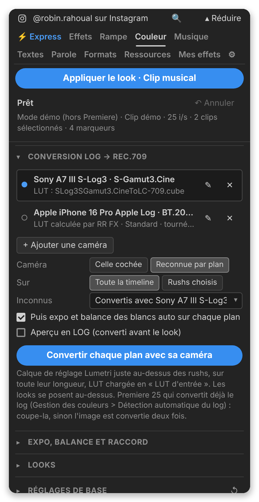</td>
</tr>
<tr>
<td width="44%">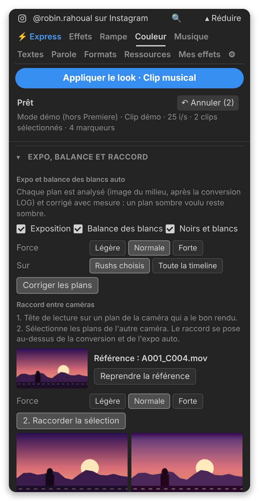</td>
<td width="56%">

### 🎯 Expo auto et raccord entre caméras

- **Expo et balance des blancs auto** : chaque plan est analysé et corrigé, avec mesure.
- **Raccord** : ton iPhone prend le rendu de ton boîtier. Choisis une image de référence, sélectionne les plans à
  raccorder, c'est fait, avec un avant/après.

</td>
</tr>
<tr>
<td width="56%">

### 🖌️ L'étalonnage comme dans Lightroom

Les mêmes panneaux que Lightroom : réglages de base, courbe des tonalités, mélangeur de couleurs, roues
d'étalonnage, calibrage.

- **Looks** prêts à l'emploi (Clip musical, Film chaud, Nuit bleue…) et avant/après sur ta vraie image.
- Un clic pour l'appliquer dans Premiere. Exporte aussi en **LUT .cube** ou en **DCTL pour DaVinci Resolve**.

</td>
<td width="44%">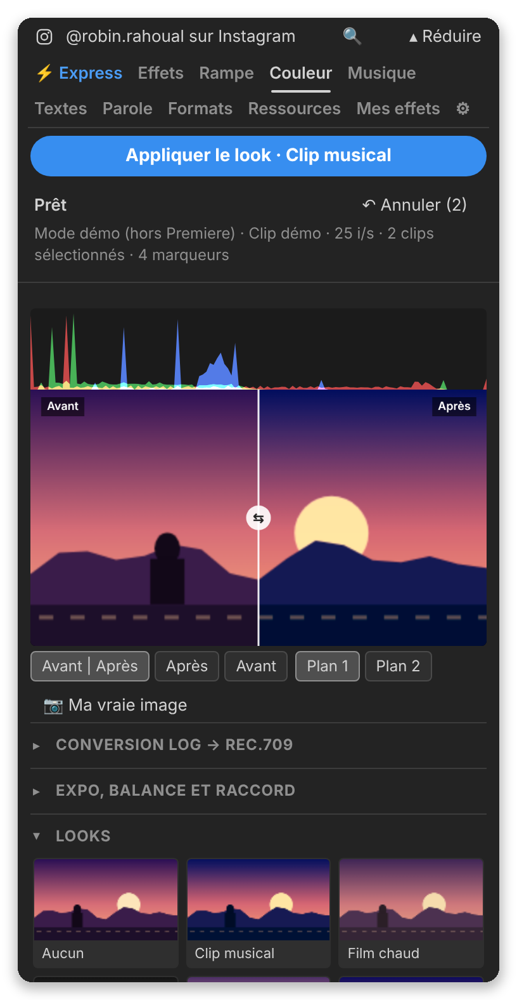</td>
</tr>
<tr>
<td width="44%">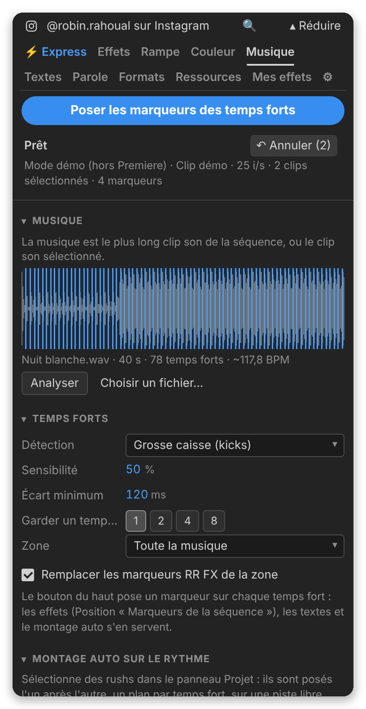</td>
<td width="56%">

### 🎵 Les temps forts de ta musique

RR FX écoute ta musique et trouve **les kicks, les caisses claires ou la grille du tempo**.

- Un clic pose un marqueur sur chaque temps fort.
- Les effets, les textes et le montage auto s'en servent directement.

</td>
</tr>
<tr>
<td width="56%">

### 🎬 Le montage qui se fait tout seul

- **Montage auto** : tes rushs posés l'un après l'autre, un plan tous les 1, 2, 4 ou 8 temps.
- **Synchro son/image en un clic** : en playback, l'image se cale sur la musique ; en multicam, les caméras se
  calent entre elles.
- **Multicam sur le rythme** : une caméra différente à chaque temps fort.

</td>
<td width="44%">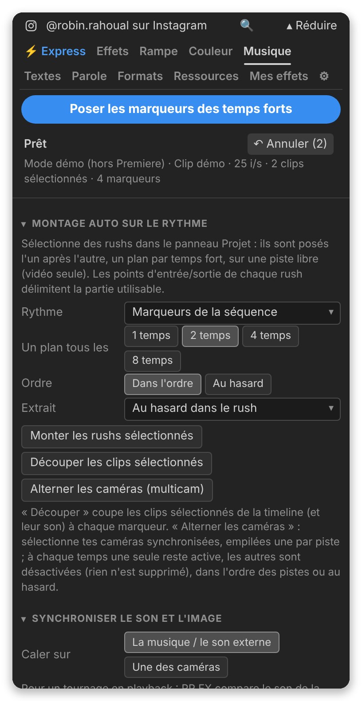</td>
</tr>
<tr>
<td width="44%">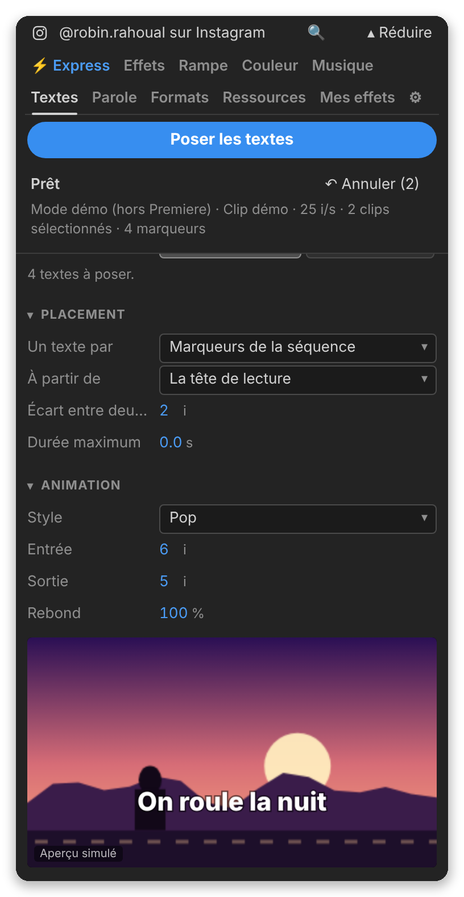</td>
<td width="56%">

### 🔤 Titres et paroles animés

Colle tes textes ou tes paroles : **une ligne par temps fort**, par marqueur ou à durée fixe, animée (Pop, Zoom,
Glissement, Impact…).

- Avec ta police et ton style : exporte un titre de Premiere en modèle, RR FX s'en sert.

</td>
</tr>
<tr>
<td width="56%">

### 🔊 Le son réglé tout seul

- **Égaliser la voix** : chaque plan parlé mesuré et amené au même niveau (-14 LUFS pour YouTube et les réseaux,
  -16 podcast, -23 TV), sans dépasser -1 dB. Débruitage en option.
- **Musique sous la voix** : la musique baisse doucement quand on parle et remonte dans les pauses (images clés
  de volume, modifiables).
- **Chapitres YouTube** : la liste « 00:00 Titre » prête à coller, depuis tes marqueurs ou les blancs du `.srt`.

</td>
<td width="44%">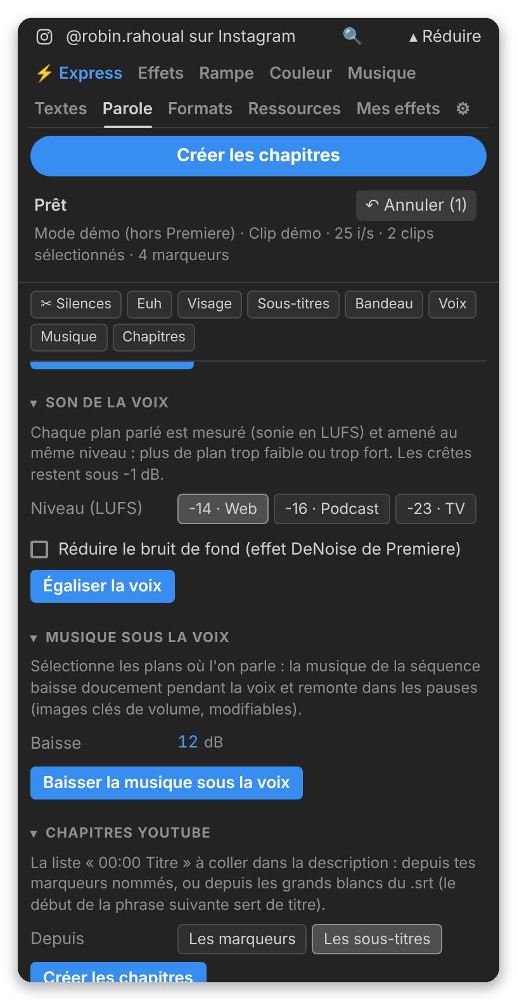</td>
</tr>
<tr>
<td width="56%">

### 📱 Prêt pour Reels, TikTok et LinkedIn

Une **copie de ta séquence en 9:16** (ou 4:5, 1:1) en un clic.

- Le **recadrage automatique** de Premiere suit ton sujet dans chaque plan.
- Ou **en suivant le visage** : RR FX garde la personne au centre du cadre vertical, plan par plan.
- Ou **sur fond flou** : le plan entier au centre, sur lui-même agrandi et flouté. Le classique des interviews et
  des vidéos d'entreprise.
- L'aperçu montre la **zone sûre**, ce que cachent les boutons de l'app.
- Ta séquence d'origine ne bouge pas.

</td>
<td width="44%">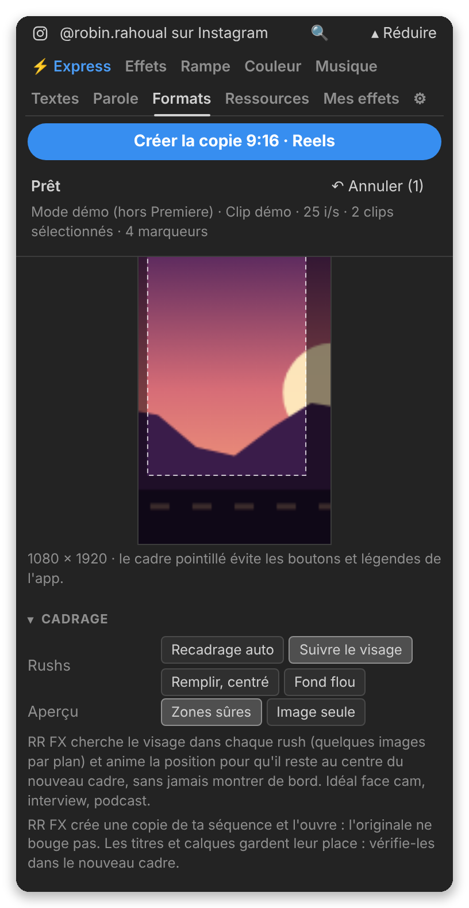</td>
</tr>
<tr>
<td width="44%">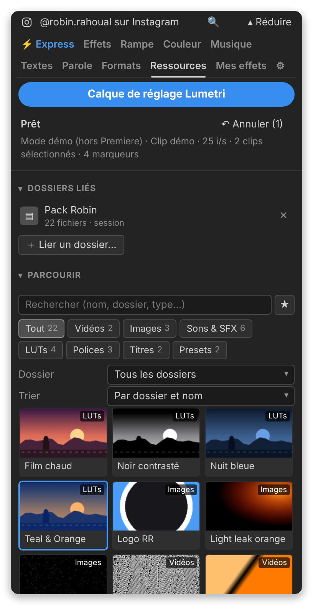</td>
<td width="56%">

### 📁 Toutes tes ressources à portée de clic

Lie le dossier où tu ranges tes **SFX, LUTs, polices, overlays et titres** : tout est classé dans le panneau.

- Écoute un son, essaie une LUT sur ton image, vois une police avant de l'installer.
- Pose un whoosh **sur chaque coupe** en un clic.

</td>
</tr>
<tr>
<td width="56%">

### ⭐ Ton style, réutilisable et partageable

- **Capture** n'importe quel effet monté dans Premiere (effets tiers compris) et réutilise-le en un clic.
- **Packs de style** : tes effets, looks, textes et overlays dans un seul fichier, pour un autre projet ou un
  pote.
- Partage un effet par un simple **code** à envoyer en message.

</td>
<td width="44%">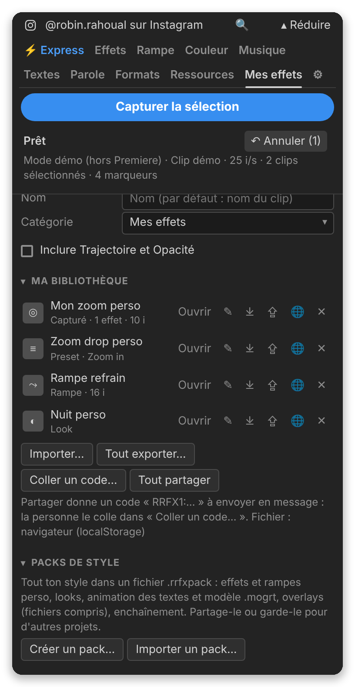</td>
</tr>
<tr>
<td width="44%">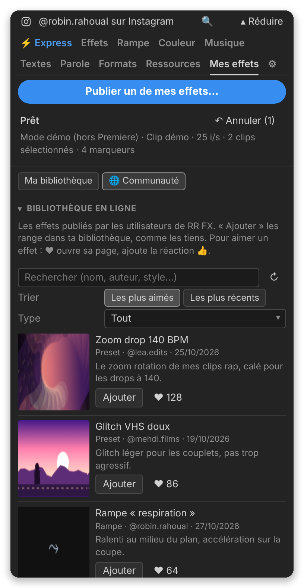</td>
<td width="56%">

### 🌍 La bibliothèque de la communauté

Les effets publiés par les autres monteurs : cherche, trie par les plus aimés, **ajoute en un clic**.
Publie les tiens en deux clics.

</td>
</tr>
<tr>
<td width="56%">

### 🔍 Tout au clavier

**Ctrl+K** (ou **/**) : tape deux lettres, appuie sur Entrée.

- Une action, un onglet, un effet, un overlay, un look ou un style : tout se trouve au même endroit.
- Et des raccourcis d'une touche pour le reste : **E** montage express, **A** appliquer, **B** temps forts, **L**
  conversion LOG…

</td>
<td width="44%">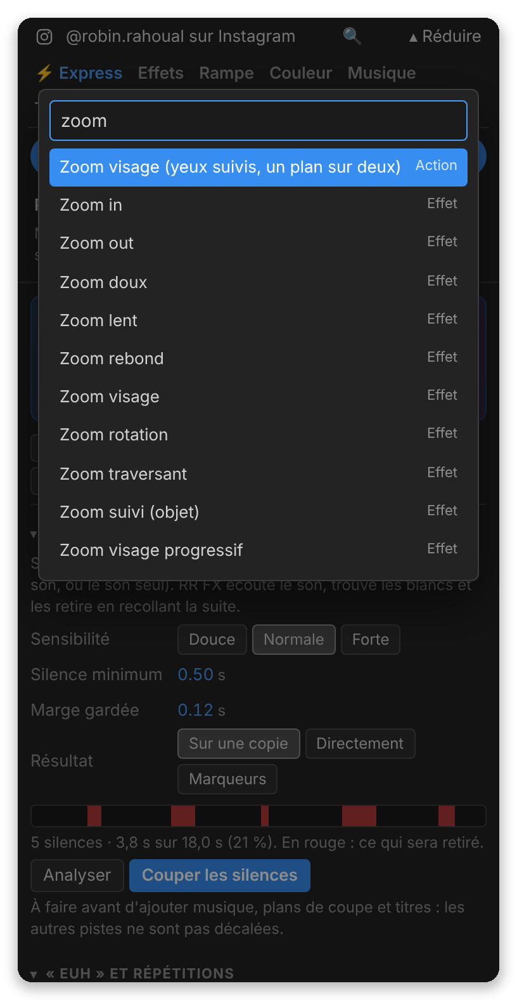</td>
</tr>
<tr>
<td width="44%">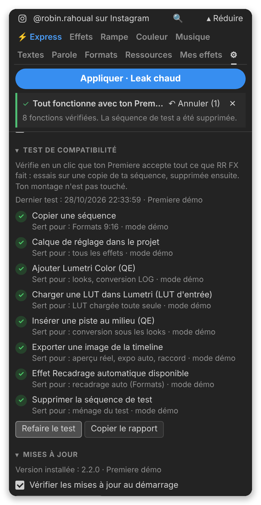</td>
<td width="56%">

### 🧪 Tu sais que ça marche chez toi

**Réglages > Test de compatibilité** : un clic, et RR FX vérifie sur une copie de ta séquence tout ce dont il a
besoin dans ton Premiere. La copie est supprimée ensuite, ton montage n'est pas touché.

- Chaque ligne dit à quoi elle sert.
- **Copier le rapport** si quelque chose coince.

</td>
</tr>
<tr>
<td width="56%">

### 🚀 Pris en main en 30 secondes, à jour en un clic

- À la première ouverture, un **accueil** te montre par où commencer.
- Quand une nouvelle version sort : **Installer la mise à jour**, directement dans le panneau. Le pack est vérifié,
  ta version actuelle est gardée de côté, et rien ne change si quelque chose se passe mal.

</td>
<td width="44%">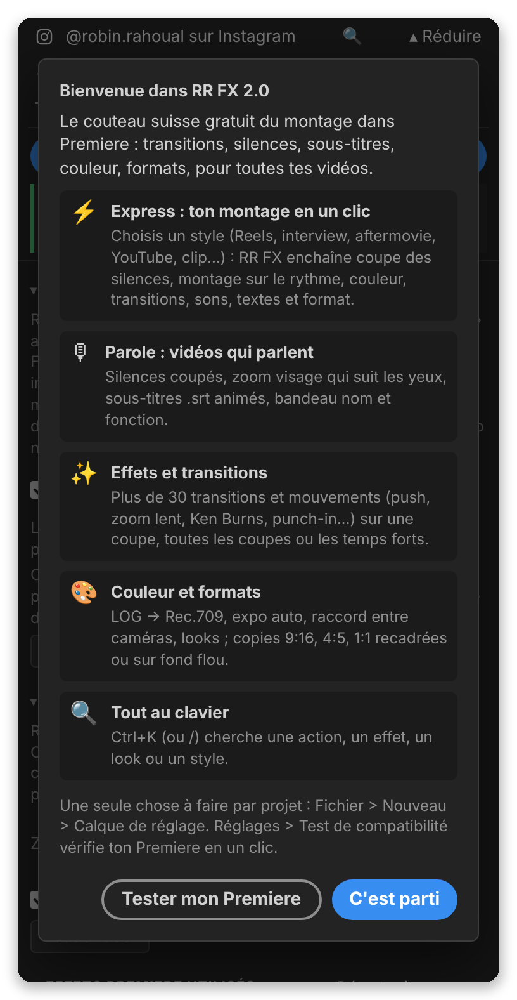</td>
</tr>
</table>

---

## Installer RR FX en 3 étapes

1. **[Télécharge RR FX](https://github.com/RobinRahoual/RRFX/releases/latest)** (fichier
   `RRFX-…-installation.zip`, section *Assets*) et décompresse-le.
2. Ferme Premiere Pro, puis lance l'installateur :
   - **Windows** : double-clique sur `Installer RR FX (Windows).bat`.
     Si Windows affiche « Windows a protégé votre ordinateur » : *Informations complémentaires* > *Exécuter quand même*.
   - **Mac** : clic droit sur `Installer RR FX (Mac).command` > *Ouvrir*.
3. Ouvre Premiere : **Fenêtre > Extensions > RR FX**.

> **Une seule chose à faire par projet** : crée un calque de réglage (*Fichier > Nouveau > Calque de réglage*).
> RR FX le retrouve tout seul.

---

## Questions fréquentes

<b>C'est vraiment gratuit ?</b>

Oui. Pas d'abonnement, pas de compte, pas de publicité.

<b>Ça marche avec ma version de Premiere ?</b>

Premiere Pro 2021 à 2026, sur Windows et sur Mac, quelle que soit la langue de Premiere (RR FX retrouve tout seul
le nom des effets). Pour en être sûr : *Réglages > Test de compatibilité*, un clic.

<b>Est-ce que RR FX modifie mes clips ?</b>

Non. Les effets se posent sur des calques au-dessus de tes plans (nommés `RR FX · …`). Seules les speed ramps et le
motion blur travaillent sur une copie du passage, posée au-dessus. **↶ Annuler** retire la dernière opération et
*Tout effacer* retire tout ce que RR FX a posé.

<b>Et la coupe des silences, je peux revenir en arrière ?</b>

Oui. Par défaut, elle se fait sur une **copie** de ta séquence (« … (sans silences) ») : l'originale reste
intacte. Tu peux aussi couper directement dans la séquence (Ctrl+Z dans Premiere pour revenir) ou seulement poser
un marqueur sur chaque silence. Fais-la avant d'ajouter musique, plans de coupe et titres : seules les pistes des
plans choisis sont recollées.

<b>Il faut une musique ?</b>

Seulement pour ce qui suit le rythme (temps forts, montage auto, paroles). Les styles Interview, Entreprise, Face
cam et YouTube marchent sans musique : leurs transitions se posent sur toutes les coupes de la séquence.

<b>Comment je mets à jour ?</b>

RR FX te prévient quand une nouvelle version sort : clique sur **Installer la mise à jour** dans le panneau, puis
redémarre Premiere. Tes effets perso et tes réglages sont gardés.

<b>Je peux l'essayer sans Premiere ?</b>

Oui : ouvre `plugin/index.html` dans ton navigateur, le panneau tourne en mode démo avec des images d'exemple.

<b>Quelque chose ne marche pas ?</b>

Clique sur **Voir le détail** sous le message du panneau : il dit ce qui a bloqué. Lance aussi le **test de
compatibilité** (Réglages) et copie le rapport. Envoie-le moi sur
[Instagram](https://www.instagram.com/robin.rahoual/) ou ouvre une
[issue](https://github.com/RobinRahoual/RRFX/issues).

<b>Je veux tous les détails</b>

Le [guide complet](docs/GUIDE.md) explique chaque réglage, onglet par onglet. Les notes techniques (tests,
publication, code) sont dans [DEVELOPPEMENT.md](docs/DEVELOPPEMENT.md).

---

Plugin gratuit créé par <b>Robin Rahoual</b> 
Suis-moi sur Instagram : <a href="https://www.instagram.com/robin.rahoual/">@robin.rahoual</a>

